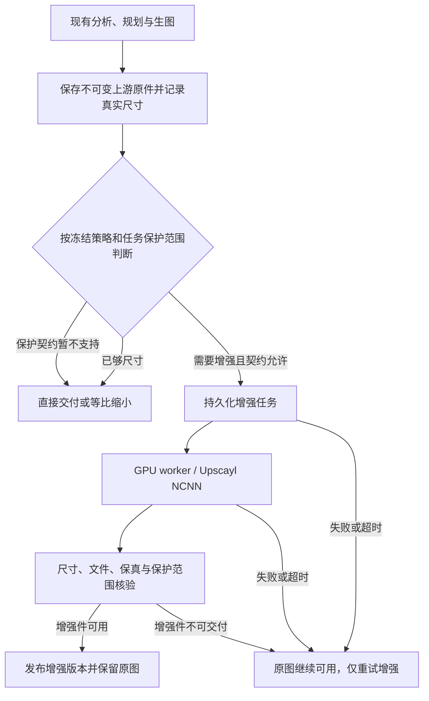
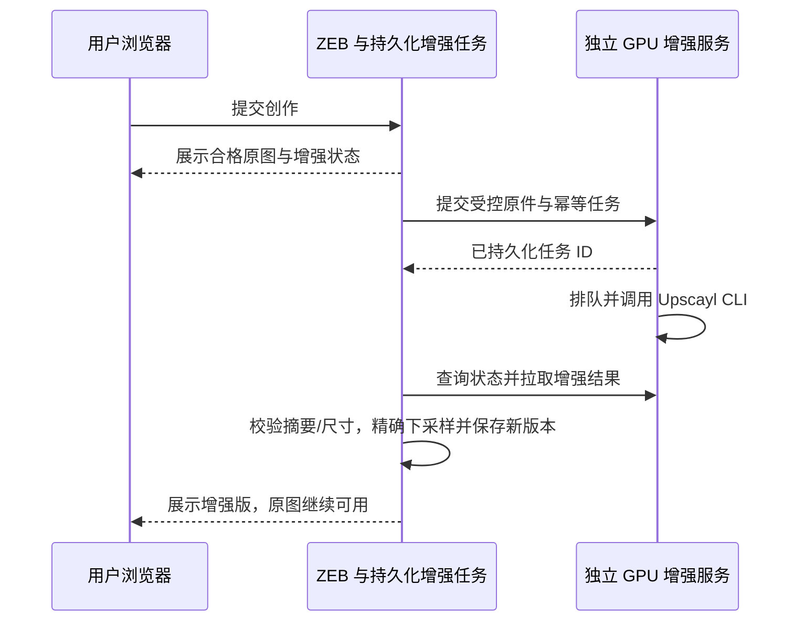

# 生图高清增强接入方案：Upscayl 与现有电商编排

当前状态：M5 用户基本验收通过，照片画质优化在后续实际使用中收集反馈；不据此认定所有照片画质或生产发布已验收。M6 本机 CLI 开发已取消，当前无 Linux GPU 验收环境，继续现有 Windows 远程 API。[M7 电商派生交付与商品保护](2026-10-25-image-super-resolution-m7-product-protection.md)已完成本期技术开发与开发测试发布，真实家居 GPU 样本和人工画质待验收，逐项证据以该记录为准；M8 未开始。保留 M7/M8 历史编号，自动 OOM 降 tile 重试继续暂缓。

以下至第 1 节保留各轮当时的开发、发布和待验收记录，以及原失败与 Unknown；当前范围以上段及第 10、12 节为准。

M5 开发及同产物开发测试发布已完成，待用户验收：原 SR-M5-01～12 的步骤和成功定义完整保留，各项按原定执行层次取得证据；F13 公开命令 v9 已完成初始化与完整业务 2/2，源码及最终实际证据独审已通过，Spec／Quality PASS，该专项无遗留项；整体 M5 保留既有 unused-config M1。F01/F02 分别取得实际后端→Windows GPU→永久媒体、三组尺寸／摘要、双版本下载／刷新、真实日志和缓存证据；一次实际图像模型调用因原生比例与目标不符明确跳过，规划为受控夹具。HTTP／永久媒体故障与配置时间线同轮 10 项、尺寸单测 64 项与初始化加 2 桌面场景、实际 Web 进程重启 1/1、管理员跳过／失败日志回读和 F13 2/2 均为独立轮次，不相加或冒称全部上游／GPU 验收。固定业务源码已中文服务器本地提交 304f313，独立新 SSH 核 25 文件工作／提交摘要一致；该源码的隔离干净构建、完整 typecheck／build 和独立无网络 Sharp PNG 编解码通过。开发 Web／generation Worker 已发布同一镜像，来源、就绪／心跳、维护入口及桌面回读通过；后续文稿闭环提交不作为该产物的构建来源；用户使用确认仍待，M6～M8 和生产／商业就绪不在此结论内。详见[实施计划](2026-10-23-image-super-resolution-generation-integration.md)。

显式编辑基线已补普通原件和已发布增强子资产的真实来源绑定：普通原件必须关联归属一致的完成 Run、成功原任务与稳定 resultId/nativeSource；增强子资产必须关联成功增强任务的已提交 publication、实际交付尺寸／字节／摘要和原件父链，metadata 或 staged 文件本身不能成为资格。B 以原图冻结基线／选区，A 增强晚到不改 B；显式选增强另建 C，保留原图根、增强父资产和独立分支。视觉分析入口与共享 assetAccessUrl 均优先永久 serverUrl，缺少永久源时沿原远端回退，原 HTTP 与 data URL 限制不放宽。

公开 F13 复现入口为在 web 目录执行 `node scripts/run-image-enhancement-e2e.mjs`；入口生成独立不透明合成原件并使用受控 LLM／image／Worker 协议，应用、持久化、选区、资产、媒体和桌面链真实执行。它不依赖私有照片或部署配置，也不替代 F01/F02 真实 GPU 或一次实际图像模型证据。重启证据脱敏回归、精确命令及各轮边界见[验收索引](2026-10-11-image-super-resolution-test-cases.md#6-m5普通完整生图的异步增强闭环)。

M5 最终并发边界：文件 Provider 的增强意图先可见时，执行器通过既有 generation 文件锁只读取得原任务快照，释放锁后才执行准备、远端调用及发布；不在锁内重写 generation 文件，不新增重试、延时或状态。PG 保持事务内原图成功与入队及执行器直读；原任务成功、归属／结果／原件身份和已持久原生技术失败门禁不弱化。 file outbox 原 I1 已修复并独审闭合；Spec Approved C/I/M=0/0/0，Quality Approved C/I/M=0/0/1，保留既有 unused-config M1，本次新增 0/0/0。F13 专项 0/0/0 不代表整体无遗留。 公开 F13 v9 初始化加完整业务 2/2、stderr 空；正常 hover 后保留原意图精确相等，并通过可信指针各帧的独立像素等式，指针专项 Spec／Quality Approved、C/I/M=0/0/0。v7 具体帧因果仍为 Unknown，v8 保持业务前准备失败，原失败轮不改写。

M5 开发环境使用验收：本轮开发发布回读时后台保持默认关闭，连接及凭据尚未配置；实际使用验收需管理员保存连接、完成连接／样图检查并开启。发布回读未保存凭据、未新生成或重跑 GPU；限宽预览仅为显示变体，不代替原生像素或新 GPU 质量证据。

M4 管理配置开发与测试发布完成：独立后台入口、默认关闭开关、加密凭据、严格 HTTPS 信任、鉴权模型与样图完整解码门禁已实现。配置／API等定向78项、独立真实PostgreSQL5项、HTTPS4项、桌面完整流程和提示可读性、类型构建及独立复审分轮通过；最终新构建管理员API真实校验既有1254²→5016²样图，无新增GPU推理，同产物测试发布与实际页面已复核。用户使用确认另列，详见[M4 实施记录](2026-10-23-image-super-resolution-admin-config.md)。不把管理面板验收冒充 M5 的普通生图异步增强／原图回退闭环。

2026-10-23 最终收口：M3 Windows 内网服务功能、实机验收及安装／对应源码材料交付已完成，见 [M3 交付清单](2026-10-23-image-super-resolution-m3-delivery.md)。最终交付复用已测 v13 运行字节，补齐两份 Sharp 构建输入及兼容修改 DLL 的独立加载／编解码验证，外层两个 finalized=true；历史候选材料及失败／Unknown 不改写。服务已有 25 个任务／157 份记录的保护基线，未重复推理或维护。历史编译来源仍 Unknown，M4 后台和业务接线、用户确认各自推进；以下同日及早期段落为历史。

2026-10-23 运行中恢复验收通过：任务 A 已授权执行、任务 B 排队时，直接停止独立服务。A 的原执行形成明确中断记录；重新启动后，A 沿用同一任务、原首次执行时间和截止时间自动恢复，新实例 GPU 自检合格后 B 自动继续，无需重提。三个结果均完整下载核验，十九个历史任务与一百一十四份记录保持，最终二十二任务／一百三十九记录，服务回到合格空闲状态。私有验收脚本读取活动日志的共享冲突已用同句柄测试复现并修正；未放松产品日志与任务校验。调用链路故障、忙时维护和最终交付仍继续，M3 未全部完成。

2026-10-23 排队跨重启验收通过：正常接口接受运行任务和排队任务，维护封口后等待运行任务自然成功，再重启独立服务。原排队任务的身份、原图和排队期限保持；新实例自检合格后，无需再次提交，原排队任务自动继续并成功。三个新结果均完整下载核验摘要，十五个历史任务与九十份记录保持，形成十八任务／一百零八记录的新保护基线。运行中中断恢复与剩余维护验收继续，M3 未全部完成。测试接口注意区分入站请求的顶层 `modelId` 与归一化输出中的 `plan.engine.modelId`；测试必须覆盖 multipart 解析之后的请求契约校验。

2026-10-23 当前实施：按内网管理员使用场景，新候选采用普通 Windows 服务启动，不要求额外启动证明握手；保留 HTTP＋Token、正常启停、任务保护和错误诊断。候选运行包／源码逐文件校验、包内 Node／SQLite／Sharp 加载、一次真实标准升级和新启动实例 GPU 自检均已通过。1254×1254 原图增强为 5016×5016 PNG，完整下载及摘要校验通过；十四个历史任务、八十四份运行记录保持，新自检加入后保存十五任务、九十记录的独立基线。安装维护失败日志位于程序目录，保留卸载或显式删除业务数据不会阻挡删除流程。剩余排队／运行中恢复、忙时维护及最终交付继续，M3 尚未全部完成。安装步骤见 [Windows 内网安装与维护](2026-10-23-image-super-resolution-windows-install-guide.md)。

2026-10-23 当前进度（优先于下方历史）：内网五参数直接恢复已实现，未使用的证明准备入口和专用分类代码已移除；本地恢复与 Store 回归、类型检查、构建及独立源审通过。内部测试机的一次真实恢复、十三个历史任务和全部历史结果保留、新进程 GPU 自检均已通过，能力恢复可用。接下来完成剩余运行中恢复、维护卸载和最终安装包；不再推进旧 SID／多层证明准备路线，M3 尚未全部完成。具体操作见同目录 [失败恢复说明](2026-10-23-image-super-resolution-explicit-recovery.md)。

2026-10-23 最新范围调整：Windows GPU Worker 服务用于内部接入，按现有管理员环境开发。安装和恢复保留 Token、防并发、服务/端口状态、完整备份、数据库检查、数据归档和失败保留；不再扩逐文件 ACL/身份封存、全系统 SID 证明、多层恢复证明或权限兼容矩阵。后续优先复用原恢复主体实现直接调用并开展实机验收，未接入的复杂准备代码退出本期并清理。详见同目录 [Windows 内网精简方案](2026-10-23-image-super-resolution-internal-windows-scope.md)。以下严格证据链进度仅保留历史，M3 尚未完成。

2026-10-23 当前态恢复新增独立证据准备入口，绑定原失败来源、停止状态、完整健康备份及独立五目录副本；使用不同证据类型保留原未知结果。来源、锁内状态与准备检查已分轮通过，备份摘要绑定及检查时序的定向缺陷已修正，源码复审收尾中。现有恢复入口尚未接新类型，实机恢复和最终交付仍待完成；完整说明见同目录的显式恢复补充，不将准备通过算作M3完成。

2026-10-23 旧运行时只读检查已实现：在完整独立五目录副本中，实际使用健康旧包 Node 与 SQLite 执行批准的新检查器。代码来源、完整依赖文件和副本前后状态均须核对，最后一次全量复核结束仍须满足原截止。十五个专项控制、完整类型检查及增量源码复审通过，安装回归另记。此为当前态恢复接线的配套检查器；完整证据准备、原锁内准入和真实恢复尚未完成，不将其标为M3或最终交付完成。

随后相关安装／恢复七项回归通过；原调用者PID与真实创建身份的只读查询也已补齐，十一项控制、原进程快照两项回归、类型和增量源码复审通过。该查询不终止原caller；权限不足或其它查询错误不得转为“没有进程”。下一接证据准备与同一原锁内执行守卫；完整恢复事务、实机新实例资格与余下矩阵仍待，不由原语通过继承。

2026-10-23 当前态恢复开发推进：进程身份拒绝门与数据库只读闭合分类已实现并分别复审。新增三十二项数据库专项检查通过，覆盖合法成功与取消竞争、恢复事件跨实例消费、已闭合中断替代历史及错误来源拒绝；检查前后测试副本文件集合与字节保持。类型检查和构建通过。早期失败分支的完整调用接线、原锁内重新取证、实际恢复及新实例资格仍待完成，测试服务没有启停，M3尚未完成。

2026-10-23 最新实际覆盖以下历史运行态：修正候选已执行一次完整正常升级，但在 Windows 服务启动阶段返回未知，当前测试服务停止；尚无新实例通过。独立只读核验确认原七十八份记录和十三张原图保持，完整健康备份的二百三十五项、其中一百四十九文件通过验证，当前五数据目录的全部成员、类型和文件内容与该备份相等；这不等于原启动失败进程的完整退出证明。已复现并最小修复诊断仅保存异常类型、不保留原异常及系统数值码的问题，两项定向回归与类型检查通过；四项关联恢复回归通过，另一个夹具摘要更新后独立通过，各轮分别记账。新诊断代码尚未构包部署，原失败与未知记录保留。具体启动根因未明，不归因安全软件；既有恢复入口缺少此阶段所需证明，不能重投、直接启动或伪造证明。下一补齐该失败阶段的独立恢复处理，再继续三组实机验收和最终交付，M3仍未完成。

2026-10-23 当前实例资格已实机收口：一次GPU自检输出原生5016×5016 PNG并取得生成资格；独立只读后验完整下载十二个结果、约140MB，逐一大小与摘要通过。旧十二个任务及七十二份原始记录保持，新任务加入后形成十三任务、七十八份记录和十三张原图的独立保护基线。原生进程自然退出、活动数为零、双输出流结束和授权封口均已逐项核对。原检查器误判正常预约记录空值的失败保留，修正协议判断后新轮独立通过；旧基线不覆盖。候选正常升级、真实失败恢复、三组实机余项和最终交付继续，M3尚未完成。

2026-10-23 实机预检补充：修正候选已上传并通过包内校验，尚未切换服务。发现当前运行进程与旧基线不同后，先独立只读重新核对身份：十二个旧任务、七十二份原始记录、十二张原图与七份外部素材保持，十一个成功结果完整下载并校验摘要通过。新运行实例的自检尚未执行，不能继承旧实例的GPU资格；应先执行一次固定实例自检并独立收口，再继续正常升级和真实失败恢复。旧基线和失败记录保留，本期M3尚未完成。

随后修正候选的完整成品复核已接受：运行归档与源码归档全部成员逐项核验，正式原生构件在来源、运行目录、解压目录与归档中一致，旧隐私问题对新准确字节关闭。本地候选阶段收口，下一推进真实服务正常健康基线、失败证明及独立恢复；不重复已通过构包轮，M3尚未完成。

2026-10-23 新候选推进：运行包、Windows包校验、包内依赖加载和对应源码快照已实际完成。复审发现旧候选正式程序集内嵌私有调试路径，已保留并拒收；三个正式项目只在发布配置关闭调试符号，新二进制及完整运行文件补充隐私检查。新构件诊断链四项、启动组合两项检查分别通过，修正候选四阶段通过，增量源码复审接受，成品独立复核收尾中。实际服务只读确认仍正常运行；下一先建立具备新合同的健康基线，再验完整服务失败恢复，不直接给旧包补能力标记。M3与最终发行尚未完成。

2026-10-23 实际接口诊断推进：真实模型拒读已通过原生进程、桥接、原调用方、适配器、任务执行器和实际数据库到达认证维护接口；同一任务和启动实例绑定、原输入保护及未授权请求拒绝均核验。相关四项真实进程检查通过，类型检查通过，独立复核收尾中。接口保留未知状态、任务槽及不可停止状态，不因错误解释完整而自动清理或重试；测试在结果记录后才围堵自己准确持有的桥接进程，不替代产品清理或恢复资格。后续固定完整候选包，继续真实服务启动失败恢复与三组实机验收；新源码未部署，M3尚未完成。

2026-10-23 原生诊断链推进：原生发送端七项针对性检查通过，两项真实权限拒绝分别核验原始管道、原权限与安装材料保持，并经独立实际复审。桥接接收侧已修正其它通道结束抢先丢弃原准备回复的竞态；仅等待原已授权请求，原截止、主动关闭和未知状态保护保持。十一项接收技术控制及上层相关两文件一百八十五项检查通过，一项既有条件跳过；三项正常真实进程回归另轮通过。新增真实模型拒读已经过原生进程、桥接层到达真实 Node 调用方，准确返回固定三字段，未授权推理。失败仍保持未知，测试中的精确进程围堵不算产品清理或恢复成功。观察通道的合法未知状态仍正常输出，不为错误测试假设增加拦截。真实 Adapter 到认证维护接口、服务失败恢复和三组实机余项继续，源码未部署，M3 尚未完成。

2026-10-23 恢复与诊断推进：独立恢复入口已在实际子进程验证，输出时原锁仍独占，同一进程自然退出后原锁释放，完整归档与恢复快照通过，有限非作者复审通过。原失败轮因测试子进程首次模块进度污染而保留，新轮仅修进度设置，不放宽错误输出要求。准备失败的三字段诊断已接至原认证维护接口；新增二十四项检查及相关六文件三百七十三项回归通过，六项既有条件跳过，类型检查与构建通过。诊断解释不改变未知状态、不释放任务槽或授权推理。该轮底层结果使用明确测试替身，真实原生错误来源与服务恢复仍待集成验收；三组实机余项及最终交付继续，M3尚未完成。 独审另发现有效性回调同步取消后仍保存诊断，已以准确失败用例复现并复用原门修复，增量复审通过。

2026-10-23 显式恢复推进：独立十参数恢复入口与完整文件恢复路径已实现。最终十二项受影响项目回归、完整类型检查通过；其中新增文件事务控制十项，覆盖两类受观察启动失败的健康备份恢复、原材料被修改拒绝、原锁缺失与真实竞争、部分目录交换、启动及清理失败。恢复先保留失败原件，再验证旧代码与健康备份；逐步交换五目录，不自动重试、删库或倒回。独审发现并修正启动助手提前写成功及清理后缺截止检查，实际原方法与完整收尾源码块分别先失败后通过；普通启动行为保持。上述验证中的服务、数据库、权限与原进程来源替身均已明确，不能替代真实服务恢复资格。独立恢复进程退出前后的锁持有、完整生产诊断、三组实机验收与最终发行继续，新源码未部署，M3 尚未完成。

2026-10-23 本轮补充：失败证据构造和原安装调用端接线已实现，本地相关九项永久回归与完整类型检查通过，源码经分段独立复审。已先复现再修复有效备份的权限误判：备份物理目录保持调用者专属权限，清单继续保留源数据权限用于恢复；失败数据本身的权限与原始字节保护保持。九项构造控制覆盖十次调用及真实权限差异，十五项调用端控制验证失败账本独立读回、原资源全部释放后才发布，同步保留原错误和截止。原生句柄、真实服务身份、完整失败证明及显式恢复仍需后续集成验收；以上本地技术控制不能替代实机资格。当前继续实现显式恢复入口，新源码尚未部署，M3 尚未完成。

2026-10-23 最新进展：启动失败帧校验与私有证据落盘已实现并加入永久回归。十二项真实存储控制通过；最终六项受影响永久回归和完整类型检查通过，各轮分别记账。证据采用固定待发布文件，完成原始材料、权限、完整字节及原截止检查后，再以不覆盖的重命名发布。另发现 Windows PowerShell 5 不支持的整数类型别名并修正两处；十三项身份消费者技术控制通过，其原生方法使用显式替身，不能据此认定真实服务身份或恢复资格。完整失败证据构造、调用端释放后发布、显式恢复及三组实机验收仍在推进；新源码尚未部署，M3 尚未完成。

2026-10-22 本次最新：升级取证私有写入已实现，十七项真实存储检查及永久回归入口通过，源码经非作者复审。固定保存旧停止事实、原始维护数据、批准的完整包清单及备份关联，完成索引最后写入，原始字节、权限、碰撞保护和原截止保持；纯存储用例不代表实际数据库验证、备份调用或服务恢复。模型权限拒绝已通过完整产品入口实测，准确返回文件打开阶段与系统拒绝访问码，原权限恢复后可重新打开；精简重复的受限令牌测试后复测通过。原升级调用端已接入，十一项调用边界控制及三项受影响永久回归通过，类型检查通过；失败证明、显式恢复、完整用户诊断、三组实机验收与最终交付继续；源码未部署，M3 尚未完成。接线须保证附加取证失败只失去恢复资格，原停止、备份和账本异常保持原处理；缺少证明不得自动恢复。以下同日记录保留各自历史范围。

2026-10-22 最新有限收口：原进程退出码读取已通过十四项真实本机检查并进入永久回归；相关启动和服务管理器检查十六项通过。宿主现从原会话提供清理错误数量及所有者释放状态，只排除原启动失败的那个预期异常，保留其它错误与原完成结果。端口占用、冷数据版本拒绝、正常启动及异常引用控制四项通过，相关停止清理六项另轮通过；原进程、完整消息、原图及记录保护分别核验，源码复审通过。当前仍须接通原截止内退出等待、当次旧版本停止和备份绑定、失败证明及显式恢复；这些本机结果不代表真实服务账户或完整恢复验收。源码未部署，M3 尚未完成，以下同日段落保留各自历史范围。

2026-10-22 启动前持久记录已实现：原始启动回执、上下文与固定清单按原字节保存，私有权限、重复写入保护及启动前重新读盘校验到位。十四项真实存储检查、两项源码顺序检查分别通过；失败诊断只接受旧完整格式或成对新增的清理错误数量和所有者释放状态，十五项解析检查通过。新增检查进入项目回归，本轮相关启动与服务管理器输出检查十五项通过，类型检查通过，旧失败轮保留。当前环境已定位退出后映像查询返回系统错误；正在以存活阶段的原句柄和映像不可变绑定补齐退出核验。宿主真实清理事实、完整失败证明、显式恢复及实机矩阵仍待，源码未部署，M3 尚未完成。

2026-10-22 调用端完整接线推进：安装、保留数据重装、升级和回退四处启动已接入观察协议，并把安装包能力与资源持有者校验移到服务配置变更之前。旧包保持普通启动；新包的固定能力标记十项检查通过。四入口正常及失败路径二十二项技术检查、启动者原句柄与系统映像十三项真实本机检查分别通过；原系统合法硬链接规则与安装包文件校验分离。真实调用端预检及诊断写入八项检查通过，覆盖准确拒绝码、私有文件权限、敏感字段排除、重复写入拒绝与原件保护。新增检查已进入项目回归，相关包校验及类型检查通过，旧失败轮保留。源码复审已接受；完整固定服务账户握手、启动前持久意图、原进程退出后的失败证明、显式恢复与实机矩阵仍待，源码未部署，M3 尚未完成。

2026-10-22 安装器调用端推进：观察启动参数传递、固定协议解析和一次本地观察管道已实现。协议解析的二百一十七项检查及八项语法边界分别通过，六份真实宿主消息按原字节验证，独立源审及实际复核通过；保持大整数创建时间、空值和失败事实，解析成功不代表可授权启动。本地同账户管道十六项检查通过，覆盖分段与截断、唯一确认、额外数据及原截止时间，原句柄和异步任务收口。三组检查进入项目永久回归，与六项相关普通服务管理器回归一并通过，类型检查通过；测试绑定错误及旧失败轮保留。固定服务身份的真实跨账户握手、完整调用端接线、显式失败恢复、繁忙恢复与最终交付仍在实施，当前源码未部署，M3 尚未完成。

2026-10-22 服务启动接入继续推进：观察模式已接入原服务的唯一异步启动与完整生命周期。最终配对构件的两个本机测试覆盖四个独占场景：等待确认时调用返回、提前停止拒绝启动、配置校验失败结束未启动生命周期、授权后诊断断连仍保留原任务直至明确停止；相关十项普通启动回归另轮通过。复审发现释放观察资源异常会覆盖原启动错误并跳过停止，已用原方法字节的受控异常先复现再修正，保留原错误并继续停止；原始图片、帧、进程身份及构件前后摘要已独立核验。恢复验收的一次准备失败保持未知，未派发生图或启停。单变量对照确认默认策略拒绝模块导入；进程级启动参数及入口进度设置修正后，远端只读准备前缀通过，标准错误输出为空、原服务身份保持、资源释放完成，无持久策略变更。新候选保留去敏失败首帧和原主错误，防重入负例在网络操作前拒绝；中间失败轮和原验收未知状态保留，未重新提交原验收。真实服务管理器与调用端完整握手、显式失败恢复、繁忙恢复及最终交付仍待，当前源码未部署，M3 尚未完成。

2026-10-22 启动诊断回传推进：真实启动入口到 Windows 宿主的三项本机技术场景通过，覆盖端口占用、数据版本不兼容和正常启动。正常启动完成诊断后仅关闭观察通道，原服务继续响应健康检查；启动失败在原进程、任务树与双输出收口后回传原原因。修复快速退出与授权登记之间的取消竞态，并保留明确停止中断观察的能力。解析边界十四项控制与原观察门十四项回归分别通过，覆盖分段、长度限制、身份绑定、重复或截断诊断；已记录的首错不能被随后合法数据或清理完成抹去。旧失败轮保留，各轮不累加为实机端到端通过。生产服务及调用端接入、显式失败恢复、真实排队和执行中恢复及最终交付仍待，本轮源码未部署，M3 尚未完成。

2026-10-22 启动诊断与权限补充：本机启动入口已能区分真实端口占用、只读数据版本不兼容及未知错误，并有界输出一次结构化启动阶段。相关三文件回归 142 项通过；复审另发现启动观察等待期间维护封口的初始化时序问题，已先复现、再移动原对象绑定修正，两个定向场景及完整启动模块 39 项回归通过，类型检查、构建和修正复审通过，各轮分别记账。凭据交付文件的真实受限身份读取测试 1 项通过，保持原内容和权限。Windows 宿主同用户技术确认门的 13 个场景通过；授权后诊断断连及受影响的两个启动场景另轮 3 项通过，观察失败保留原已启动进程，随后显式停止并完整收口。旧测试标记读取失败记录保留。恢复验收的唯一排队任务比较门离线 26 项通过，尚未发起真实恢复。生产服务与调用端完整诊断链、显式恢复、其余实机验收和最终交付仍待，新源码尚未部署。SR-M3-01 已移出本期，不阻断、不计通过。

2026-10-22 升级与后验验收：标准升级、完整冷备份、新启动唯一 GPU 自检及独立后验检查通过。1254×1254 原图增强为 5016×5016 PNG，GPU 自检完成像素解码；后验完整读取三份指定结果并核验长度和摘要。原十一任务、六十六记录与新增自检按角色保持，十二关联任务、七十二记录和十二份原图写入新保护索引，原基线保留。验收脚本已修正 JSON 字段顺序导致的误拒绝，改为严格核对五项图片属性，旧失败记录保持。重复安装早拒绝已验；真实任务中断恢复、启动失败与最终交付仍待。SR-M3-01 已移出本期，不阻断、不计通过，M3 尚未完成。

2026-10-22 下载调用链补充：新的独立场景已由实际开发后端取得原结果前缀、原样送达调用方，并触发调用方真实正文空闲超时；收口原连接后，查询同一任务并完整下载原结果，摘要、前缀匹配及完整像素解码通过。既有十一任务、六十六记录及原图保持，无新增推理。旧下载探针的 Unknown 保留，不回填、不重放；该子项不等同 Worker 自身超时或业务自动重试。包含协作停止的新候选包及对应源码已完成本地四阶段检查，运行服务尚未升级；真实 queued/running 恢复、启动失败与最终发行继续验收。SR-M3-01 移出本期、不计通过，M3 尚未全部完成。

2026-10-22 协作停止推进：异步关闭核心与真实启动入口已接通。停止时先封存接入并中断原执行，等待完整请求处理、文件操作、引用和独立原生证据，最后关闭数据库；启动尚未完成时也沿用首次截止，不因迟到结果续期或把 Unknown 改成成功。本机启动入口相关回归 67 项通过，薄 Windows 宿主原有与新增场景共 21 项通过；正常合作无需强制终止，忽略命令、挂起后代或硬故障仍由原宿主兜底并保留失败原因。三十秒限制的是合作资格，原生调用或内核写入未收口时仍为 Unknown，不保证任意系统调用物理按时结束。当前运行服务与安装包未更新；真实繁忙任务的启动入口、原生执行和重新恢复组合仍待验证。一次下载故障探针因未形成活动窗口而保留 Unknown，不计超时通过、不重复探测。SR-M3-01 已移出本期，M3 尚未全部完成。

2026-10-22 可控中断封口正例：本机实际业务模块和普通原生执行器组合已通过。先固定仍存活的原执行进程，调用中断入口并关闭调度，再由独立读取器严格校验原授权、控制丢失和终止记录，最后清理外层测试宿主。原任务、排队任务、槽位、图片及记录保持，原进程句柄和输出收口。中断入口不把资源关闭等同任务可恢复；服务停止仍需等待请求处理、底层文件操作及原生证据后才能关闭数据库。该正例不代表生产宿主协作停止、自动恢复运行任务或 M3 全部完成。

2026-10-22 宿主中断前置验证：本机实际 HTTP、持久队列、Runner/Store 与普通原生执行器的隔离组合通过。任务 A 已授权运行、B 排队时停止宿主；缺少可信终止记录后，恢复判断保持 Unknown，保留原任务、槽位和图片，不启动替代执行。原进程树、宿主输出和句柄已收口。受影响宿主回归及旧 JSON 自然路径定向检查通过。此项只验证缺证时防止重复执行，不代表自动恢复运行中任务、真实繁忙服务、GPU 或 M3 全部完成；后续仍需完善可控停止的封口及恢复链。

2026-10-22 最新 M3：v9 标准升级、实际开发后端唯一 GPU 自检及后续完整收口、普通 HTTP 队列容量/幂等/FIFO/单槽均已验。三个增强结果完整下载并像素解码，原八任务/四十八记录保持，新增后十一关联任务/六十六记录，全部执行树与引用收口；八任务持久保护基线保留，本轮新增记录另由实际回执保护。随后上传请求超时子项通过：实际开发后端只发送未完成图片正文，服务按真实三十秒配置返回完整超时错误，原结果可完整读取，十一已知任务/六十六记录与输入目录保持，上传资源归零，无新增推理。排队运行中断恢复、启动失败、执行或下载阶段链路故障仍待验，M3 与两个最终发行标记未完成。干净 Windows 离线安装 SR-M3-01 已按用户决定移出本期，不阻断 M3、不计通过。此说明覆盖下方相应历史待验状态。

2026-10-21 当前 M3：部分通过。真实服务、Session0 GPU、自动启动、重启后已有任务与完整结果保留，以及同运行字节对照版的升级、显式回退、默认保留卸载和原身份重装均已有分轮实际证据；三个维护新启动实例各自完成一次 GPU 自检与资源收口。此说明优先于下方早期状态。启动失败、迁移拒绝、完整任务恢复矩阵、实际调用链路及干净离线前提仍需验证，M3 与最终发行标记保持未完成。

2026-10-20 传输方案调整：用户明确全程内部调用，M3 内网部署使用 HTTP，保留 Token 认证，不再要求 PFX/证书信任前置。HTTPS 保留兼容，HTTP/HTTPS 的安装、维护、备份回退使用同一明确配置且不自动切换协议。详见[内网 HTTP 安装与维护](2026-10-20-image-super-resolution-internal-http.md)。旧阶段强制 TLS 的记录保留为历史；当前专项验证不能代替真实固定服务、Session0/GPU 和 M3 全部验收。

日期：2026-10-10，Asia/Shanghai；更新：2026-10-12。状态：用户已授权按独立里程碑实施，限定开发测试环境，不创建 PR 或发布正式环境。M1 原生交付清理和尺寸展示已实现，定向回归 9 文件 188/188、格式检查、完整 Web 类型检查、lint 与生产构建均通过，最终独立复审无遗留问题；桌面 Chromium 4/4 通过（3 项准备、1 项受控上游业务验收）。应用与生成 worker 已使用同一已验产物发布测试环境，应用健康；真实生图补充案例 `SR-M1-LIVE-01` 的原生交付、刷新、下载及同源引用已通过，用户人工验收仍待完成，该案例未发生 GPU 增强。M2-A 协议、配置及图片校验基础层已完成 96/96、类型检查、构建和独立复审；增强 API、认证、持久队列、执行器、安装包、后台开关和真实端到端增强尚未交付。业务图片 A/B、容量与实际后台身份 GPU 验收仍待完成。

## 1. 推荐结论

在现有图片任务之上增加独立的 `image_enhancement` 阶段，以可替换的增强 Provider 调用官方 Upscayl NCNN 命令行引擎。ZEB 继续处理创作、模型路由、任务、素材和交付。当前沿用 Windows 远程 worker API 与 HTTP＋Token，不开发 ZEB 本机 CLI 模式；选择 HTTPS 时继续校验服务身份，认证由实际连接协议决定。

替换的是低分辨率结果的直接插值放大职责。Sharp 继续负责解码、方向和色彩归一、等比缩小、编码、缩略图以及经过保护契约约束的像素合成。不要在通用 `normalizeGeneratedImageBytes()` 中直接启动 GPU 推理：该函数同时被素材存储、尺寸读取等路径引用，容易造成重复增强和日志保存触发推理。

当前业务服务器只识别到 VMware 虚拟显示适配器，没有取得可用 Vulkan 计算 GPU 的证据。用户随后明确 GPU 位于 Windows 主机，优先采用 Windows 原生远程 worker；具体运行主机须在实施前完成 GPU/驱动及实际运行方式下的 CLI 推理探测。Vulkan 并不要求 CUDA，不能把 NVIDIA 写成唯一选项，也不承诺当前 CPU 虚拟机能稳定运行软件 Vulkan 超分。

超分提高可见细节和边缘观感，但推测细节无法变成真实商品事实。场景的透视、主体保真、光线和陈设质感仍由生成与规划负责。

## 2. 实施前核对的项目基线

本次从现有开发快照通过 CodeGraph 读取源码；相关生产代码可对照公开提交 `35210ad664f19a7b63f8dd29eaaa1431abd5975e`。用户描述的原生 `1254×1254` 用作方案输入示例，本次没有重新提交生图请求验证该具体输出。

| 现状                               | 证据与影响                                                                                                                                                         |
| ---------------------------------- | ------------------------------------------------------------------------------------------------------------------------------------------------------------------ |
| 普通生图在素材写入时进行尺寸归一   | `generation-log-repository.ts:128` 的 `writeAssetBytes()` 调用 normalizer，原始 bytes 随后被归一后的 bytes 替换。需要在这一变换之前保留上游原件。                  |
| normalizer 使用 Sharp resize       | `generated-image-normalizer.ts:14–30`：目标与原件不同即 `rotate().resize(..., fit: cover)`。这会插值；画幅不同时还可能裁切，不能作为提高真实细节的证据。           |
| 当前 4K 别名不是明确的 4K 像素契约 | `image-task-types.ts:85–96`：`4k → high`，`high=2880`；`image-task-size.ts:107–126` 以面积和比例计算尺寸。方图会成为 2880×2880，其他比例不能一概说也是 2880×2880。 |
| 普通任务与电商受约束任务不同       | `image-task-result-service.ts:18–54,183–228`：canvas、分层、部分原生 Gemini 路径有不同保存分支；不能替换一个函数就宣称全链路支持。                                 |
| 局部编辑已有可重建的像素保护       | 原生候选、蒙版、合成原件分别留存；验收重新执行映射/合成并比较真实像素和摘要。全图超分会破坏选区外零变化承诺。                                                      |
| 商品场景也可能有保护契约           | `product_to_scene` 的任务包含商品保护区域，即使没有 `sceneProtection` 也不能当普通完整生成图放行全图增强。                                                         |

核心调用链：

```text
上游生成 / 轮询完成
  → image-task-runtime.prepareImageTaskResults
  → image-task-result-service 分支处理
  → normalizeAssets
  → writeAssetBytes
  → normalizeGeneratedImageBytes
  → 存储及任务结果
```

新增增强边界应放在图片任务结果准备/交付层，由该层传入明确 scope 和冻结的增强策略；存储层只写已经明确身份的原件、候选和交付件。

## 3. 明确 4K 的产品与数据含义

请求尺寸、生成质量和交付尺寸分开定义。`high` 可以是生成质量参数，但不能隐式等价于 `4k`。

- 方形 4K 建议定义为 4096×4096。
- 16:9 示例可以明确为 3840×2160；其他比例按项目约定给出准确宽高。
- 用户明确输入宽高时保留该宽高；局部编辑默认保留已确认源图画幅。
- 上游支持并实际返回足够分辨率时，优先直接使用，跳过 AI 放大；能力以当前渠道实测为准。
- 超分不负责把错误画幅裁成正确画幅。比例真正不符时转入原有画幅处理/说明流程，不能静默裁掉商品。

以用户样例说明：

```text
上游原生       1254×1254
AI 原生 4x     5016×5016
最终交付       4096×4096（等比下采样）
产品标识       4K 增强版 / AI 超分
```

不得称这张图为“上游原生 4K”。日志同时保存 `requestedSize`、`providerNativeSize`、`inferenceSize`、`deliveredSize`。尺寸从真实文件解码取得，不从请求参数复制。

## 4. 目标流程与交付体验



先展示可用原图和“高清增强中”；增强完成后，在仍属于同一结果版本时切换默认展示/下载件，保留原图入口。增强失败展示“高清处理未完成，原图可用”，只提供增强重试，不重新运行视觉分析、规划或生图。

生成成功与增强状态分开持久化。不能将可用原图标成失败，也不能将高清处理未完成标成“4K 增强成功”。已有原件的合法性和保护验收仍按原契约执行。

沿用已采纳的结果验收原则：摄影质感与语义建议保持可观察，不因新增的主观审核把已可用图片再次强制暂停。增强件的确定性技术失败只使该增强件不可发布，原始合格结果继续可用。

## 5. 可替换的增强契约

建议新增内部 `ImageEnhancementPlan` 与 `ImageEnhancementResult`，不把某个模型或 Upscayl 版本写死在生图模型配置里。

任务冻结以下内容：

| 类别     | 必要内容                                                                       |
| -------- | ------------------------------------------------------------------------------ |
| 输入身份 | 上游原件资产、原始摘要、解码尺寸；方向/色彩归一后的引擎输入摘要另存            |
| 输出要求 | 明确目标宽高、格式、色彩策略、保护 scope、允许的变换                           |
| 引擎快照 | Provider、二进制版本/摘要、权重名/摘要、模型倍率、tile、TTA、运行参数          |
| 保护依据 | 商品锚点、当前场景基线、蒙版/区域及其摘要、保护契约版本                        |
| 生命周期 | queued/running/succeeded/failed/skipped/cancelled、lease、尝试次数、原因和产物 |
| 溯源     | provider native → engine input → AI intermediate → final delivery 的真实关系   |

增强模块提供统一任务接口，当前由远程适配器调用独立 Windows 增强 worker 的任务接口，复用引擎参数、产物校验和结果契约。原 `LocalNcnnAdapter` 设想随 M6 取消；SSH CLI 仍为未交付的后续可选适配器，不伪装成 HTTP Provider，也不自动回退到 SSH。业务编排只依赖增强接口，后续可切换其他超分引擎或权重，不影响 LLM 分析、编辑规划和生图模型的选择。

触发由确定规则判断，无须新增一轮 LLM 调用。幂等依据包括输入摘要、目标尺寸、scope/蒙版摘要、引擎与模型版本、完整策略快照。同一请求恢复不能重复创建生图任务。

## 6. 不同任务的增强策略

| 任务类型                                     | 推荐行为                                                                                                           |
| -------------------------------------------- | ------------------------------------------------------------------------------------------------------------------ |
| 无商品/蒙版/分层/canvas 保护的普通完整生成图 | 首期接入。原生尺寸不足目标时执行 AI 超分；已够尺寸则跳过。                                                         |
| 无像素保护、但有固定画幅要求的完整场景图     | 后续在冻结的 delivery v2 契约下开放。分别核验真实 native 与允许的派生交付尺寸。                                    |
| `product_to_scene`、严格商品保护任务         | 按实际商品保护区域/蒙版判断，不能只检查 operation 名或 `sceneProtection` 是否为空。保护区不得被整图增强静默改写。  |
| 已有高分辨率底图的局部编辑                   | 保持源画幅。后续增强上游候选或带上下文区域，再只在确认蒙版内写回；选区外直接复制原始源像素。                       |
| 源图自身低于 4K 的局部编辑                   | 局部修改保持原源画幅；“整图放大至 4K”是另一个明确的增强/导出操作，不能同时声称整图尺寸变化且选区外源像素逐点不变。 |
| 分层、透明商品素材                           | 首期跳过。alpha、色彩、图层关系单独通过真实样例后再开放。                                                          |

局部编辑和商品保护接入时必须使用独立版本的增强证据：保留真实上游 native、增强中间件、映射/合成方式、最终件、保护蒙版和摘要。技术验收验证原生图及已保存增强中间件的真实尺寸、摘要与映射，并用增强中间件、冻结源图及蒙版重建最终合成；不要求重新运行 AI 推理产生相同摘要。允许编辑或增强的蒙版以外像素必须逐点不变，其中包括商品保护核心区。不能把增强后的图片地址写入原来的 `nativeUrl`，也不能借超分把 `nativeMatches=false` 改成 true。

已有 canvas 的 exact/ratio 检查仍真实描述上游输出。新增允许派生高清交付的契约，应在任务创建时冻结并单独验收 `deliveryMatches`，不能在失败后临时放宽原契约。

## 7. 连续编辑与晚到结果

原始商品锚点永久保留。当前场景基线必须指向用户看到并确认使用的明确版本；开始下一次编辑时冻结资产 ID、variant、尺寸与摘要。

后台增强完成不能覆盖用户已开始的编辑或新的会话分支。只在任务/结果版本仍匹配时更新该结果的默认展示件；原始件和增强件都保持不可变。用户选择增强版本继续编辑时，创建通过技术检查的新资产/分支，保存根资产、parentResultId 与 branchId，再显式注册为本次场景基线，之后的选区坐标和像素保护以它为准。不得覆盖原 assetId 的内容或仅替换 URL；晚到增强不得改变既有选区与编辑快照。

避免重复链式超分：基于 provenance 与策略快照检查是否已经足够尺寸、是否已增强。局部编辑交付不能在合成之后又自动进行整图增强。

## 8. Upscayl worker 的首期形态

使用官方独立 `upscayl-bin`，不部署 Electron，不把 Upscayl Cloud API 文档当成自托管现成 REST 服务。当前 Windows 远程 API 的 HTTP/任务接口由项目提供；已有 OpenSSH 仍只是后续可选调用路线。桌面应用、原生命令行引擎与自建增强 API 是不同交付物。

增强 worker 使用 TypeScript/Node.js，复用 ZEB 技术栈与任务契约；AI 计算由固定版 Upscayl C++/NCNN CLI 执行。Windows 已交付包含运行时的轻量安装包与开机自启服务；引擎与模型单独配置、固定版本，不要求安装包内含全部权重。服务身份须有真实 GPU 推理证据；如改用其他启动方式须单独验收。Linux 可复用核心协议的设想不作为当前开发或验收要求。

官方默认模型为原生 4x。CLI 的任意目标尺寸功能包含推理后插值，首期让 CLI 只输出完整 AI 倍率结果，精确等比下采样交 Sharp。若找不到满足倍率/像素预算的路线，则报告不支持，不自动二次连续 4x。

实施参数原则：

- 首期一个 GPU worker 并发 1，tile 按实测显存选择；暂不开 TTA、Double Upscayl 或激进锐化。
- Standard 与 High Fidelity 先做保真 A/B，再确定默认，不能凭模型名认定优胜。
- 输入为未被拉大的上游原件；引擎输入只做必要的一次方向/色彩/格式归一，原件 bytes 不覆盖。
- 以受控参数数组启动 CLI，明确超时、取消、资源上限和独立临时目录；读取退出码后继续真实解码检查输出。
- 对确定的显存不足最多做一次降低 tile 的增强重试；不自动重发生图，不无限重试。
- 分别设置上游输入、AI 中间产物与最终交付的像素/字节预算；审查现有 20MB 输入限制和 40MP 解码限制，不能只放宽某一处。
- 中间件保留无损 PNG；最终照片编码沿用明确质量/色彩策略，受保护的像素验收件保持无损。
- 固定二进制、权重与运行环境版本。Upscayl 桌面与 NCNN CLI 均为 AGPLv3，独立进程/服务边界不自动消除许可义务；部署材料保留上游版权、许可证和对应源码来源，候选权重的独立许可在启用前逐项核对，不能套用底层 Real-ESRGAN 的 BSD 许可代替。

不在 Web 请求处理或日志序列化里等待 GPU 完整运行；用持久化任务/lease 承载异步执行和恢复。进程重启后仅恢复增强阶段。

### 运行位置与调用方式

当前使用 Windows 独立 API worker，本机 CLI 模式已取消。Linux 可承载远程 API 的部署设想不变，但当前没有对应 GPU 环境，不纳入本期交付或验收。操作系统只影响二进制、路径、驱动和运行权限，认证仍按实际连接协议确定。

| 部署组合                                                                    | 调用方式                              | 后台必要配置                                                           | 身份认证                                                    |
| --------------------------------------------------------------------------- | ------------------------------------- | ---------------------------------------------------------------------- | ----------------------------------------------------------- |
| 同物理机，但推理在独立进程/宿主系统，ZEB 容器不能直接执行其二进制或访问 GPU | 独立 worker API，必要时走宿主访问地址 | 服务地址、该服务采用的认证及 TLS 信任配置                              | 即使服务在同物理机，也按实际网络连接认证                    |
| ZEB 与 GPU 位于不同机器，双方可为 Windows 或 Linux                          | 远程 worker API                       | 服务地址、认证方式、对应服务凭据、TLS 信任                             | 自建服务密钥为首期默认；服务账号密码或 mTLS 为单列扩展能力  |
| 已有 Windows/Linux OpenSSH，选择不暴露增强 HTTP 接口                        | 远程 SSH CLI（后续可选）              | 主机、端口、SSH 用户、密码或私钥、可信主机指纹、远端引擎/模型/工作路径 | SSH 密码或公钥认证；可选私钥口令，不能拿 API Token 登录 SSH |

Windows 宿主上的 Linux 容器不能默认直接执行宿主 Windows `.exe`；它的 `localhost` 也不是宿主机。Docker Desktop 可使用其明确提供的 `host.docker.internal` 访问宿主服务；Linux Engine 的宿主访问方式需按部署拓扑配置，不能无条件套用该名称。WSL2/虚拟机也按实际执行环境验证，不依赖跨系统 shell 互调作为隐式兼容。远程 worker 内部继续以受控参数启动 CLI，取消与恢复只跟踪本任务，不使用全局 kill 或重发生图。

### 自建 API Token 如何在本地实现

以下为待开发 worker 的认证方案，不是 Upscayl 桌面现有能力，也不是需要向第三方申请的 API Key：

1. 管理员在 GPU 主机首次初始化增强 worker 时，通过本机安装/管理入口生成专用访问密钥。建议用密码学安全随机源生成 32 字节随机值并作 Base64URL 编码；无需联网或云账号。不开放未认证的远程“获取密钥”接口。安装/管理入口本身属于待开发交付物，不要求管理员手工编造密钥。
2. 明文只在该次本地生成操作中显示，管理员复制到 ZEB 后台的密码输入框。worker 持久保存密钥标识及随机密钥的摘要校验值；不能每次启动重新生成，服务重启也不会改变认证。
3. ZEB 将实际需要发送的密钥按现有服务端敏感配置机制加密保存；已通过 CodeGraph 核对 `secret-crypto.ts` 的 AES-256-GCM `encryptSecretValue` / `decryptSecretValue` 可复用。这里是新增配置接线，不表示增强字段已经支持加密。
4. ZEB 后端在增强请求中发送 `Authorization: Bearer <访问密钥>`。worker 对收到的密钥做同算法摘要及固定时序校验，成功才允许能力读取、任务提交、查询、下载与取消；拒绝请求不得启动 GPU。随机高熵密钥的摘要校验与用户密码的慢哈希校验是不同设计。
5. 本期管理员维护的内网部署默认使用 HTTP＋Token，跨主机调用无需 PFX 或额外证书初始化。Token 用于认证，不提供传输加密；如部署者显式选择 HTTPS，则沿用证书信任与地址校验，不自动降级协议。公网部署不在本期范围。
6. 密钥支持显式替换与吊销，旧密钥吊销后拒绝新访问。已有任务与稳定服务/客户端身份关联，密钥轮换不会触发重新生图或隐式迁移到别的服务器；执行/结果已持久化的任务可在更新为有效凭据后检查同一任务。任务冻结模型、输入、执行方式与服务身份，认证使用该连接当前有效的凭据引用，不把旧密钥明文冻结进任务。端点改变不能把旧远端任务 ID 发给新服务。

访问密钥只授予增强接口权限，不是 ZEB 管理员密码、模型渠道密钥或 Windows/Linux 登录密码。保存后不回显明文；留空且未提交凭据表示保持原值，清除必须是明确操作。配置、任务快照、错误和审计只记凭据引用/版本，不复制密钥、密码或私钥。

### 账号、SSH 密钥与证书的区别

| 凭据或信任项               | 所属连接                         | 实际含义                                                                          |
| -------------------------- | -------------------------------- | --------------------------------------------------------------------------------- |
| 增强服务访问密钥           | worker HTTP API                  | worker 自己生成并校验的应用凭据，与操作系统账号无关                               |
| 增强服务用户名/密码        | HTTP Basic 等明确支持的 API 协议 | worker 的专用服务账号；密码使用成熟密码哈希实现，远程传输必须 TLS，不复用 OS 登录 |
| HTTPS 服务端证书/受信任 CA | HTTPS                            | 让 ZEB 确认连接的是预期服务；通常不能代替客户端认证                               |
| 客户端证书及私钥           | 双向 TLS（mTLS）                 | 服务端验证 ZEB 客户端身份；需配置双方信任、有效期及更新规则                       |
| SSH 用户及密码/私钥        | SSH                              | 登录远端系统执行受控命令；私钥可有独立口令，授权应限制到所需引擎/目录             |
| SSH 主机公钥指纹           | SSH                              | 验证目标机器身份，不是登录凭据；不能无提示自动信任变更                            |

Windows OpenSSH 的当前常规路线以其官方支持的 password/publickey 为准。SSH 私钥、公钥、主机指纹、OpenSSH 证书和 TLS 的 X.509 证书不能使用一个含糊的“证书”上传框混用。首期不引入域登录、Kerberos 或跨 OS 用户映射。

当前实施范围为 Windows 远程 API，使用专用访问密钥；HTTP＋Token 适用于当前内网部署，HTTPS 保留服务端身份校验/内部 CA 配置。API 服务账号密码、mTLS 和 SSH 适配器均为未交付的单独扩展，不显示尚未实现的可选项。不能把历史 SSH 小样成功当作持久业务适配器已完成。

## 9. 管理员开关、无 GPU 部署与可观测性

用户已明确要求：AI 超分必须是后台可选功能，并非所有部署服务器都有 GPU。这是首期必需项，不后置为运维配置工作。

### 后台配置

管理员后台新增“AI 高清增强”独立开关，默认关闭，配置保存到现有管理员系统配置机制；不依赖修改环境变量或重启容器。关闭状态也允许配置增强 Provider/连接信息、执行连接测试和查看只读就绪状态，避免“开启前必须检测、开启后才能配置”的循环。开关只决定是否为后续任务启用增强；适用范围和模型策略放在可展开的高级设置内。普通用户仍使用一句话创作及分辨率选择，不需要配置 tile、权重或增强提示词。

后台提供增强开关、当前远程 API 的连接与模型配置，以及连接和样图检查。只展示已交付能力，字段与操作如下：

| 配置或操作        | 行为                                                                                       |
| ----------------- | ------------------------------------------------------------------------------------------ |
| AI 高清增强开关   | 默认关闭；检测通过后允许开启；保存后对新任务生效                                           |
| 调用方式          | 当前为远程 worker API；M6 本机 CLI 已取消，不提供本机模式选项                              |
| API 连接字段      | 完整服务地址、该服务支持的认证方式及对应凭据                                               |
| API 专用访问密钥  | 以密码框输入；保存后只显示已配置，支持明确替换或清除，不回传明文                           |
| API TLS 信任      | 系统信任或内部 CA/明确自签信任；校验服务名称/地址，不通过关闭证书校验实现连通              |
| 后续 SSH 专用字段 | 实现后再展示主机、端口、系统用户、密码/私钥及口令、可信主机指纹与远端受控路径              |
| 默认增强模型      | 从鉴权能力接口获取；显示真实可用模型及原生倍率                                             |
| 检查配置/连接     | 由实际后端执行环境检查远程连接、身份认证，显示分阶段结果及检测时间                         |
| 样图自检          | 在与业务相同的生成 worker 身份、容器及 GPU 环境执行小样；API 模式覆盖 ZEB 到远端的实际链路 |

API 使用增强服务凭据；未来 SSH 模式才需要远端系统账号与密码/私钥，不能把系统账密误用为 HTTP 认证。地址、认证方式/凭据、信任或默认模型改变后，旧就绪结果失效，需重新检查。

任务冻结连接档案、执行模式、服务身份与模型策略，但凭据仅保存受控引用或版本，不复制明文到任务 JSON、前台响应或日志。后台展示连接、认证、GPU/模型及真实样图就绪状态；仅端口可达或 `/healthz` 成功不能显示“增强可用”。

后台同时展示两个事实，不能将“已开启”误当成“有可用 GPU”：

- 配置开关：管理员希望是否使用增强。
- 执行就绪状态：未配置、待检测、就绪、不可用；当前对应远程 API，未交付模式不列为可用。

首次开启前执行配置、能力和实际样图检查，确认远程执行身份、Vulkan 设备与所选权重就绪，不能只测端口可达。没有可用执行器时给出具体原因，保持开关未启用。已启用服务临时故障时保留管理员配置意图，实际任务回退原图；服务恢复后新任务可再次使用，不改写已经冻结或正在执行的任务。后台连接凭据仅管理员可设置并脱敏显示，不写入前台任务、普通调用记录或公开文档。

建议默认只触发“请求 4K 且原生尺寸不足、任务保护契约允许”的图片。增强 Provider/profile、默认保真模型、并发/超时和原图回退策略在后台配置并随任务冻结。沿用已有权限、灰度与回退机制，不增加普通用户的内部策略设置。

### 无 GPU 时必须完整可用

主应用及默认 Compose 启动不依赖 GPU、Vulkan、模型权重或增强 worker 的健康状态。默认关闭时不下载超分权重、不安装 GPU 运行库、不探测本机引擎，也无需启动独立增强 worker；Web 服务只保留轻量增强接口与契约，当前 API 模式只需要轻量网络客户端。后台开关决定任务路由，不自动安装或启停已部署的 worker；关闭开关不取消已有任务，开启开关也不能代替引擎/服务部署。

GPU worker 是可选部署组件，当前以独立 Windows 服务运行；业务主机无 GPU 也可连接该远程 worker。Linux GPU Compose 不在本期范围。不能在默认 Web 镜像添加必须初始化 Vulkan 的依赖，不能给所有服务器强制添加 GPU device 配置或服务依赖。

| 配置/运行条件                         | 图片处理与用户结果                                    | 后台记录                                                  |
| ------------------------------------- | ----------------------------------------------------- | --------------------------------------------------------- |
| 默认关闭                              | 按普通生成流程交付可用原图，不请求增强服务            | `skipped / disabled`                                      |
| 已开启，worker 就绪且原件不足目标     | 执行增强，成功后发布独立增强版本                      | 真实 AI 引擎与三组尺寸                                    |
| 原件已够尺寸                          | 直接交付或等比缩小                                    | `skipped / native_sufficient`                             |
| 保护契约不允许                        | 保留原保护交付路径                                    | `skipped / protected_contract`                            |
| worker 不可用、无 GPU、超时或增强失败 | 原图仍可查看/下载，仅增强阶段失败或跳过；允许单独重试 | 明确 `provider_unavailable`、`timeout` 或具体增强失败原因 |

默认回退为合格原图，并保留真实原生尺寸。用户于 2026-10-11 明确目标是画质提升，不是单纯增加像素尺寸；首期取消低分辨率结果静默插值至目标 4K 的交付方式，不新增传统插值兼容模式。超分关闭、不可用或失败时，交付原件并显示实际尺寸与未增强原因，不能把 Sharp 插值当作 AI 超分成功，也不能标为上游原生 4K。Sharp 保留解码、方向归一、编码、缩略图和等比下采样职责；原件已满足目标时无需 AI 超分。

开关只决定后续任务的策略。对于已进入增强中的任务，按已冻结策略完成或由管理员明确取消增强，不能仅切换开关就撤回已交付结果、重发生图或改变编辑基线。

### 可观测性与验证

调用记录新增独立增强阶段，包含真实输入/推理/交付尺寸、native 与增强件关系、跳过原因、队列/推理/编码耗时、模型版本、重试、错误及最终交付模式。后台可对比原生图、现有 Sharp 插值基线和增强候选；原图/增强图下载身份一致、不会混淆。

首期必须在完全没有 GPU/worker 的环境验证：默认启动、后台保存开关、普通生图、原图下载、不可用回退都正常。普通 CI 不引入 GPU 依赖；适配器契约、状态恢复和拒绝路径使用确定的边界测试，真实 GPU 推理另做受控集成验收，不能将 mock 结果当真实超分质量证据。

### 旧插值逻辑清理专项：先核对共享调用，再实施

本专项已进入 M1 实施。下述调用链是实施前基线；当前候选已移除普通插值补像素，并通过定向回归，测试发布与桌面端到端验收另记实际结果。用户所指“逻辑放大”在本方案中具体指生成结果为了补足目标宽高而执行的普通插值，不是生成模型、LLM 规划或所有 Sharp 图像处理。

已通过现有 CodeGraph 的 `status`、精确 `node` 与 `callers` 查询核对：索引 complete、无 pending changes、无工作树不匹配。`normalizeGeneratedImageBytes` 的五个索引调用条目中包含测试文件及文件级导入；实际直接调用该函数的生产函数为下表两处，不能把导入条目当成额外执行路径。

| 调用位置                                                         | 当前职责与传参                                                                           | 清理方案                                                                      |
| ---------------------------------------------------------------- | ---------------------------------------------------------------------------------------- | ----------------------------------------------------------------------------- |
| `generation-log-repository.ts` 的 `writeAssetBytes`              | 保存图片时传入 `context.targetSize`，普通任务及生成日志共用；非图片不调用图片 normalizer | 删除原生不足时插值补尺寸的行为，继续读取真实格式/尺寸及落盘；保留既有合法缩小 |
| `ecommerce-generation-service.ts` 的 `decodeEcommerceCanvasSize` | 不传目标尺寸，只读取解码后的方向与宽高；分析、规划、选区和技术检查依赖它                 | 完整保留，不因去掉放大而删除尺寸读取函数                                      |

上层还须核对五个已定位的共享素材保存调用：`persistPreparedResults`、`persistCanvasBatch`、`persistSceneProtectionResults` 内的 `save`、`normalizeTaskResultAssets`、`recordGenerationLog`。其中普通 `persistPreparedResults` 会传 `resolveResultSize` 计算的目标；`writeImageGenerationLog → recordGenerationTaskLogResult → normalizeTaskResultAssets` 是日志侧再次进入素材保存的路径，不能只改任务交付而留下日志二次补像素。

旁路边界已经核对：带电商 canvas 契约的原生批次不传目标尺寸；分层结果保持原生大小；特定自定义 Gemini 的非精确尺寸结果已有原生保留逻辑；受保护局部编辑使用独立原生证据和源坐标合成。索引用于定位这些边界，不据此宣称所有结果都经过插值。

拟实施规则：

1. 请求尺寸仍是发给上游的创作意图；结果尺寸从实际文件读取，两者分别记录。不要删除仍用于上游请求、交付缩小及日志的尺寸解析函数。
2. 按 EXIF 方向归一后的宽高判断是否需要放大。原件任一边不足目标时，普通保存直接保留原字节与真实尺寸，不中心裁切或重编码成目标画幅。不能只比较像素面积，也不能只增加 `withoutEnlargement` 就声称原件完整保留。
3. 删除普通插值补像素的执行行为及依赖它的过时断言；保留 MIME/尺寸读取、资源校验、既有合法缩小与 JPEG 4:4:4 编码。预览缩略图、局部选区映射和商品保护合成不在删除范围。
4. 同时核对任务结果、生成日志、刷新后读取、下载与继续引用的实际尺寸和字节。已有永久素材不得因重新记录日志而复制、再次缩放或覆盖原件。
5. 区分“用户请求 4K”和“实际交付 4K”。原生不足且未完成 AI 超分时显示真实尺寸；AI 结果标为增强版本，不能以请求参数为依据展示原生 4K。
6. 已同步更新 `AGENTS.md` 中“精确目标强制规范化”的旧要求；待测试/待办按实际实施状态更新，防止后续开发恢复插值假高清。不足分支完整解码后保留原件，合法缩小使用 `inside` 保全画面；AVIF 以真实容器和 AV1 codec 识别，不根据调用方 MIME 猜测格式。

独立验收使用同一原件，至少覆盖以下边界；只执行受影响桌面流程，不新增手机端或无关媒体矩阵：

| 场景                               | 通过标准                                                    |
| ---------------------------------- | ----------------------------------------------------------- |
| 原生两边不足请求 4K                | 输出字节、原生尺寸保持，任务和日志都不补到 4K               |
| 仅一边不足，且原生总面积仍大于目标 | 仍不插值补像素；原件完整保留                                |
| JPEG 含 EXIF 旋转方向              | 以展示方向判断真实宽高，保留原件与有效方向信息              |
| 原生已等于目标或更高清             | 等尺寸原字节保留；既有合法缩小和 JPEG 色度行为仍通过        |
| 普通协议图片保存及日志回读         | OpenAI/自定义普通路径的文件、记录、刷新、下载和引用宽高一致 |
| 原生 canvas、分层与受保护局部编辑  | 原有原生证据、失败清理、源画幅和选区外像素保护回归保持      |

完成本专项后才接入远程增强路由。它不依赖 Windows API 已部署，可以独立验收和回退；AI 服务未上线期间不以普通插值替代增强。

## 10. 分阶段实施与验收

详细用例见 [M0～M8 测试与验收索引](2026-10-11-image-super-resolution-test-cases.md)，当前共 80 项规格：M6 六项本机适配用例已移除，M7/M8 编号保留。M1～M5 的已交付范围及各轮证据见索引；M5 用户基本验收通过，M7 技术开发及开发测试发布完成，真实家居画质待验，M8 未开始。自动断言数量不等于全部业务规格通过，历史 86 项统计和各轮回归数量保留当时含义。

| 阶段                                                                     | 交付内容                                                                                                                                           | 独立验收标准                                                                                                                                                                                                                                                                                                                                                                  |
| ------------------------------------------------------------------------ | -------------------------------------------------------------------------------------------------------------------------------------------------- | ----------------------------------------------------------------------------------------------------------------------------------------------------------------------------------------------------------------------------------------------------------------------------------------------------------------------------------------------------------------------------- |
| 准备（索引及 Windows 远程 CLI 小样已通过，业务 A/B 待做）                | CodeGraph；冻结 4K 尺寸定义；确认 GPU/驱动与实际运行方式；有限家居样本离线 A/B                                                                     | 实际可推理、原生/推理/交付尺寸清楚；资源与耗时实测；无商品明显漂移；128 方图成功不能代替业务图片验收                                                                                                                                                                                                                                                                          |
| 前置阶段：旧插值清理（已测试发布，真实模型技术验收通过，用户验收待完成） | 按共享调用链移除普通插值补像素；保留真实尺寸、原生字节、合法缩小及独立保护；同步仓库旧规则与展示语义                                               | 9 文件 188/188、格式检查、完整 Web 类型检查、定向 lint、生产构建与最终独立复审通过；桌面受控上游请求 4096²、交付原生 1254² PNG，刷新、下载摘要及同资产引用通过，Chromium 4/4 含 3 项准备与 1 项业务。应用及生成 worker 同产物测试发布；另以 `SR-M1-LIVE-01` 单次真实生图验证请求 4096²、返回/展示/下载 1254²，刷新与同源引用通过，无第二次生成、无 GPU 增强。用户验收单独记录 |
| 第一阶段：普通完整生成图（M5 基本验收通过）                              | 保存原件；确定性增强路由；异步任务；独立增强状态；管理员默认关闭开关与远程 API 配置；认证/TLS/能力检测；样图自检；完整阶段日志；原图回退与单独重试 | 无 GPU/worker 时默认启动和普通生图正常；API 密钥离线生成、重启保持、可替换/吊销，错误认证或服务身份不可信时不推理；凭据加密且不回显、不进入任务与日志；首次就绪检查覆盖实际执行环境；1254 方图样例可真实 AI 4x 后交付明确 4K 尺寸；已够尺寸跳过；关闭或失败时保留原生尺寸与原图；重启/重复提交不重复生图                                                                      |
| 第二阶段：电商场景（M7 技术开发及测试发布完成，真实画质待验）            | 新冻结 delivery/保护证据契约；根据商品保护区域区分全图与区域增强；持续保留商品锚点                                                                 | 不伪造原生尺寸；结构/颜色/文字/材质经样本对比；受保护像素保持约定；技术保护失败仍拦截增强件，视觉建议不撤回可用原图；按桌面入口验收                                                                                                                                                                                                                                           |
| 第三阶段：局部高清修改（M8 未开始）                                      | 带上下文的候选/区域增强；严格映射；仅蒙版内写回；新增可重建证据                                                                                    | 同尺寸选区外逐像素零变化；边缘、接触阴影和纹理衔接自然；刷新/下载和继续编辑使用同一冻结版本                                                                                                                                                                                                                                                                                   |

当前继续 Windows 远程 API，M6 本机 CLI 已取消，不作为开发或验收前置；没有 Linux GPU 环境，不新增 Linux 本机安装交付。SSH 适配器、API 服务账密与 mTLS 仍为后续按需扩展，各自验收后再开放后台选项。M7/M8 按原编号推进，自动 OOM 降 tile 重试继续暂缓。

用户已发出实施指令，按独立切分持续推进，先在开发测试环境验收；增强阶段单独开关、各阶段保留回退范围。本方案不包含正式发布或 PR 创建授权。M2-A 基础层不能代替整个 worker：持久化、认证、调度恢复、真实 CLI、Windows 安装与远端业务链路各自取得证据后再标记完成。

验收素材建议包括木纹家具、织物、玻璃/细杆、带标识商品、纯色墙面/柔和阴影，以及一个局部选区靠近主体边缘的案例。优先用同一上游原件对比三种输出，避免因重新生图而失去可比性。

画质验收以 100%/200% 局部裁切和目标展示尺寸观察，确认更清楚且没有假木纹、文字变化、光晕、塑料感或 tile 接缝。没有原生高清真值时，锐度或 SSIM 分数不能单独证明细节真实。记录实际队列等待、推理耗时、峰值资源及失败恢复，不提前承诺秒数。

2026-10-11 已完成的探测：Windows SSH 认证、SFTP 与直接 CMD 调用正常，`upscayl-standard-4x` 将合成小样从 128×128 增强至 512×512，CLI 退出码 0，输出 PNG 完整解码通过，耗时约 5.1 秒，Vulkan 日志识别 RTX 4090。业务服务器到 Windows 的 SSH 握手另已通过；当前真实推理由 Codex 电脑发起，不代表 ZEB 到增强 HTTP API 的完整链路已经实现，也不能外推为业务 4K 图片的性能或画质结论。私人测试记录与素材不进入公开交付材料。

测试聚焦受影响的尺寸/持久化、增强路由、任务恢复、原件留存、保护证据、最终下载与桌面 UI；不增加手机适配或与变化无关的重复测试。

## 11. CodeGraph 开发 SOP

实施前索引基线：1,685 文件、28,175 节点、86,755 边；当时索引状态 complete、pending changes 为 0，Git 工作区干净。本轮实施已有源码、测试及文档未提交改动，当前索引状态以每次 `sync/status` 结果为准，不能沿用基线数字声明工作区干净。两处数据库文件曾报告解析无符号，后续涉及它们时必须定点核对，不能把索引当作完备调用图。

```text
首次进入一个尚未索引的开发工作副本：
  codegraph init --yes .

已有索引，开始任务时或源代码更新之后：
  codegraph sync .
  codegraph status --json .

先查精确符号与调用链：
  codegraph node --path . normalizeGeneratedImageBytes
  codegraph callers --path . normalizeGeneratedImageBytes
  codegraph explore --path . --max-files 2 '<具体符号或文件>'

编辑之后、提交之前：
  codegraph sync .
  codegraph affected --help
  按实际命令支持范围选择受影响测试
```

只有索引结构损坏或提取版本不兼容时才考虑全量重建。正常更新使用 sync。跨工作树/分支先核对当前 HEAD、index project 与 worktreeMismatch；当前主机 CLI 索引不等同于其他机器 MCP 服务看到同一绝对路径。

CodeGraph 已显示的源码无需重复完整读取；遇到索引无覆盖、动态调用不明或解析失败时，按明确文件/符号补充小范围读取或 `rg`。索引是导航工具，不能替代真实源码、测试和运行证据。

`.codegraph/` 已被 Git 忽略，本轮已在 `.dockerignore` 排除索引，避免将本地缓存带入 Docker 构建上下文。未配置长期后台索引或自动 Git hook；源码变更后继续显式执行 `sync/status`。

## 12. 本机与远程 GPU 部署方式

当前沿用 Windows 远程 API。M6 本机 CLI 模式与原本机安装步骤已取消；独立 Windows worker 内部运行受控 CLI 不属于被取消的 ZEB 本机模式。Linux GPU 安装及容器适配不在当前范围，未取得实机验收，不据此声明支持已验证。

### 远程 API：当前分离主机推荐路线

远程只部署独立的高清增强服务；ZEB 主应用、账号、业务数据库、原图存储和生图模型路由继续留在业务服务器。当前两台主机通过内网 HTTP＋Token 通信；选择 HTTPS 时按第 8 节校验服务身份。浏览器只访问 ZEB，不直接访问 GPU worker。



### 远程 API 的部署组成与责任

| 位置                  | 部署内容                                                                          | 边界                                               |
| --------------------- | --------------------------------------------------------------------------------- | -------------------------------------------------- |
| 业务服务器            | 现有 ZEB；增强客户端；后台开关；业务任务状态；原生与增强资产存储                  | 无 GPU 依赖，现有数据库拓扑保持不变                |
| GPU 主机              | 当前为 Windows 原生；Linux 远程 API 为未验收的后续可选部署                        | 在实际进程账户/启动方式下确认可推理                |
| 增强服务进程或容器    | 项目封装的任务 API/执行循环、固定版 `upscayl-bin`/`upscayl-bin.exe`、受控模型目录 | 单独部署，不需要 Electron 或完整 ZEB               |
| GPU 主机持久化目录/卷 | 任务索引/队列、独立输入/输出目录与结果摘要                                        | 不挂载业务数据库，不持有用户登录凭据或生图渠道密钥 |

首期一个服务实例、GPU 推理并发 1，以持久化任务索引及独立任务目录承载恢复；不为第一阶段额外强制引入 Redis 或复制业务数据库。队列设置容量与等待时限，满载时明确拒绝新增任务并保留业务原图，不能无限堆积 GPU 工作。多实例调度是后续容量需求，不能直接将同一个本地任务卷挂给多个执行实例。服务访问密钥只授权增强接口，不授予业务数据库权限。

### Windows GPU 主机：当前优先路线

用户的 GPU 已在 Windows 主机，无需为了增强服务迁移到 Linux。首期直接使用 Windows 原生命令行引擎与后台进程，不强制 Docker Desktop、WSL2 或 Linux 虚拟机。

以下保留最初安装与开发顺序；当前 Windows 交付及实机结果以 M3 交付清单、M5 记录和本文顶部状态为准，不再把其中“待开发”作为当前缺口。

1. 用户可先安装 Upscayl Windows 桌面版，选择家居测试图手动放大，确认显卡驱动、基础可运行性与效果。这是人工验证；桌面应用本身不等于已经部署了可供 ZEB 访问的 HTTP 服务。
2. 自动化运行固定版本的 Windows CLI 与模型。官方固定发布 `20251207-174704` 提供 `upscayl-bin-20251207-174704-windows.zip`；固定二进制/权重版本与摘要，不依赖桌面软件自动更新后的内部安装路径。
3. 项目开发 Windows worker，封装原生 CLI 的异步任务、鉴权、能力检查、持久化队列、超时/取消与结果下载；不通过点击桌面窗口自动化执行。先在实际运行账户下验证原生后台进程，再根据 GPU 可用性验收选择 Windows 服务或登录后计划任务自启动，不能仅凭交互桌面手动成功推断所有后台运行方式都可用。
4. 在 GPU 主机本地初始化专用访问密钥，默认启动 HTTP 服务；不要求证书或额外启动证明握手。密钥摘要和任务状态持久保存，服务重启不重新生成密钥。已有 OpenSSH 可用于安装与诊断，不把系统登录密码用于业务 API。
5. 项目同时开发 ZEB 增强客户端、后台调用方式/服务地址/访问密钥/TLS 信任配置与默认关闭开关，复用下文同一 HTTP 契约；Windows 与 Linux worker 不需要两个不同的业务协议。
6. 保持开关关闭，从实际 ZEB 后端完成 Token 认证、能力探测与端到端样图验收，之后再开启；选择 HTTPS 时另验其证书配置。Windows 服务不可达或增强失败时交付原生图；恢复先查询原任务，避免重复执行。无需通过休眠、注销或切断整机网络验收这一行为。

职责划分：用户可以先完成显卡驱动和桌面效果验证；Windows worker 与 ZEB API 接入均属于待开发部分，可以并行开发，之后联调。不能把“安装桌面版完成”当作“仅开发 ZEB 一侧客户端即可调用”。

### Linux GPU：不在当前交付范围

远程 API 与操作系统解耦，未来可在具备 Vulkan 计算 GPU 的 Linux 环境独立部署；届时需另行确认驱动、CLI/模型、设备透传、持久卷及实际身份下的完整链路。当前没有 Linux GPU 环境，不保留本机安装或 GPU Compose 的本期交付要求，也不把 Windows 证据外推为 Linux 已通过。

### 后续可选 SSH 路线

SSH 模式的后台才显示系统用户名、密码或私钥/口令、SSH 主机指纹及远端受控路径。选择它可以不暴露增强 HTTP 接口，但仍须部署固定入口的远端 runner：用 SFTP 传递受控输入，用持久任务标识、状态/结果文件和精确进程归属处理幂等、并发、取消与断线恢复。不能仅依赖一条长时间 SSH 命令或认为通道关闭后 GPU 进程必已终止。

Windows 与 Linux 的 shell、路径、账号权限和进程树处理需分别验收，不能把未经验证的通用命令字符串作为跨平台协议。SSH 密钥/证书能力按所选客户端与目标 OpenSSH 版本单独核对；已完成的 SSH 小样只证明连接和 CLI 可运行，不代表这条适配器已交付。API 路线失败时不自动改用系统账密或 SSH。

### 远程 API 拟开发的服务接口

以下保留 ZEB 封装服务最初的协议建议，不是 Upscayl 官方已有 API；实际已交付接口与验收状态以 M2/M3/M5 记录为准，不将此表的历史“待开发”标记作为当前结论。

| 接口                                     | 职责                                                                                                  |
| ---------------------------------------- | ----------------------------------------------------------------------------------------------------- |
| `GET /healthz`                           | 进程存活，不能据此判定 GPU 可用                                                                       |
| `GET /v1/capabilities`                   | 稳定服务身份；经设备、权重和启动样例验证的就绪状态；模型白名单、倍率、版本、像素/字节限制             |
| `POST /v1/enhancement-jobs`              | 流式提交图片与冻结策略；校验摘要、限制和幂等键，持久化成功后返回 202 与任务 ID                        |
| `GET /v1/enhancement-jobs/{id}`          | 查询排队、运行、成功、失败或取消，返回真实尺寸、摘要与结构化原因                                      |
| `GET /v1/enhancement-jobs/{id}/result`   | 鉴权后流式下载已保存的 AI 中间产物，交由 ZEB 校验、下采样和持久化                                     |
| `POST /v1/enhancement-jobs/{id}/receipt` | ZEB 校验并永久保存后幂等确认接收；校验产物摘要及任务归属，供保留/清理判定使用；TC1 新补充的待开发接口 |
| `DELETE /v1/enhancement-jobs/{id}`       | 显式取消增强并传播到子进程，不删除业务原图或已发布结果                                                |

所有网络接口执行第 8 节的认证与传输规则；存活检查不返回敏感配置，也不能代替能力与真实推理检查。首期使用 ZEB 上传图片、轮询状态并主动拉取结果的模式，无需共享文件系统，也无需远程服务回连业务系统。worker 不接收任意外部图片 URL 或任意命令/模型文件路径。幂等键覆盖原件、方向归一后输入、完整引擎策略和任务范围；提交响应丢失时以同一键恢复，不盲目创建另一任务。

原生文件与增强件均保留到业务端接收确认及既定保留期满足之后；清理与重试不得删除仍被运行任务引用的文件。队列重启恢复只涉及增强任务；ZEB 是用户创作与发布结果的权威来源，远端不能自行覆盖资产或触发生图。

### 按调用方式进行首次验收

| 方式或范围         | 通过标准                                                                                                                                                |
| ------------------ | ------------------------------------------------------------------------------------------------------------------------------------------------------- |
| 同机独立或远程 API | 从实际 ZEB 后端环境验证 Token 鉴权，再提交、查询并拉取样图；选择 HTTPS 时另核服务身份；不以浏览器连通或端口开放代替；错误/缺失/已撤销密钥不得推理       |
| API 配对与重启     | 密钥本地生成；仅首次显示；双方重启后仍有效；替换或吊销有效；同服务已有任务可用有效凭据继续查询，切换端点不会错查另一服务的 job ID                       |
| 后续 SSH           | 待适配器实现后独立验收密码与私钥登录、主机指纹拒绝变更、SFTP/runner、断线恢复及精确取消；当前不记为支持或通过                                           |
| 远程 API 任务契约  | 同一输入/策略重复提交不重复入队；worker/业务进程重启可恢复状态；输出真实 native/AI/交付尺寸一致；关闭/不可用/超时不影响原图查看下载，只允许单独重试增强 |
| 无 GPU 默认部署    | 默认关闭时无引擎依赖且普通生图可用；后台只能开启已交付并通过实际执行检查的模式；受保护任务继续遵守分阶段准入                                            |

仅验收本次实际部署和已交付的模式，Windows/Linux、原生/容器不做无关组合穷举。连接、身份、环境、实际样图与恢复分别记录结果，不能把其中一项通过汇总成整条链路已完成。

## 13. 来源

- [当前 normalizer](https://github.com/ZpitQ/VOZEB-PRO/blob/35210ad664f19a7b63f8dd29eaaa1431abd5975e/web/src/lib/server/generated-image-normalizer.ts#L14)
- [普通结果准备与持久化分支](https://github.com/ZpitQ/VOZEB-PRO/blob/35210ad664f19a7b63f8dd29eaaa1431abd5975e/web/src/lib/server/image-task-result-service.ts#L18)
- [素材写入层](https://github.com/ZpitQ/VOZEB-PRO/blob/35210ad664f19a7b63f8dd29eaaa1431abd5975e/web/src/lib/server/generation-log-repository.ts#L128)
- [质量与 4K 别名](https://github.com/ZpitQ/VOZEB-PRO/blob/35210ad664f19a7b63f8dd29eaaa1431abd5975e/web/src/app/api/image-tasks/image-task-types.ts#L85)
- [目标尺寸推导](https://github.com/ZpitQ/VOZEB-PRO/blob/35210ad664f19a7b63f8dd29eaaa1431abd5975e/web/src/app/api/image-tasks/image-task-size.ts#L85)
- [Upscayl 官方 Guide：模型倍率](https://github.com/upscayl/upscayl/blob/a00d55fee90e0f9435d5eaa86e76700df8199af8/docs/Guide.md#scale-option)
- [Upscayl NCNN 独立引擎与 CLI 源码](https://github.com/upscayl/upscayl-ncnn/blob/d02fa88e078e7109fd689932453362430144014d/src/main.cpp)
- [官方 GPU 条件及局限](https://github.com/upscayl/upscayl/blob/a00d55fee90e0f9435d5eaa86e76700df8199af8/README.md)
- [NVIDIA Container Toolkit：驱动能力与 Vulkan](https://docs.nvidia.com/datacenter/cloud-native/container-toolkit/latest/docker-specialized.html#driver-capabilities)
- [官方 CLI 固定发布：含 Windows 命令行包](https://github.com/upscayl/upscayl-ncnn/releases/tag/20251207-174704)
- [Node.js Crypto：安全随机数与摘要比较](https://nodejs.org/docs/latest-v22.x/api/crypto.html)
- [Bearer 请求认证与传输要求：RFC 6750](https://www.rfc-editor.org/rfc/rfc6750.html)
- [HTTP Basic 的账号密码与传输要求：RFC 7617](https://www.rfc-editor.org/rfc/rfc7617.html)
- [Node.js TLS：证书链与服务身份验证](https://nodejs.org/docs/latest-v22.x/api/tls.html)
- [Microsoft：Windows OpenSSH 服务器认证配置](https://learn.microsoft.com/en-us/windows-server/administration/openssh/openssh-server-configuration)
- [Microsoft：Windows OpenSSH 密钥管理](https://learn.microsoft.com/en-us/windows-server/administration/openssh/openssh_keymanagement)
- [OpenSSH：主机密钥验证](https://man.openbsd.org/ssh_config#StrictHostKeyChecking)
- [OpenSSH 证书格式与用途](https://man.openbsd.org/ssh-keygen#CERTIFICATES)
- [Node.js 子进程：spawn 与平台行为](https://nodejs.org/docs/latest-v22.x/api/child_process.html)
- [Docker Desktop：容器访问宿主服务](https://docs.docker.com/desktop/features/networking/networking-how-tos/)
- [Docker Engine：网络与容器回环](https://docs.docker.com/engine/network/)

补充的官方部署/模型/许可证研究与局部编辑调用链证据保存在私有研究目录，未提交公开仓库。

## M3 补充：真实服务身份的启动前访问检查

Windows 祖先目录权限改由真实 SCM Host 在创建服务工作 Node 前检查，保持原权限掩码及外部 ACL 不写；安装器先授予最小自有权限，旧“所有 ACL 改动前拒绝”的测试合同显式迁移。实现方法、分阶段验收和 Deny/ACL 恢复易错点见[启动前访问检查计划](2026-10-20-image-super-resolution-service-startup-access.md)。Host 14/14 与真实 NTFS 安装器权限 2/2 是各自范围的技术证据，完整安装包、真实固定服务、Session0 GPU 和生命周期仍需分别验收。

## M3 补充：执行目录与引擎路径兼容性

真实后台执行已暴露并定位两个不同边界：执行目录缺失会让 `CreateProcessW` 返回错误 267；当前 Upscayl 的模型目录若使用 Windows extended 路径，会在启动后退出 `0xC0000409`。后者已用同一引擎、模型、输入和参数的单变量 A/B 证实，普通 DOS 模型目录可完成输出，而添加 extended 前缀会复现崩溃。不能将两个阶段混为权限、显存或安全软件问题。

Runner 在原准备权限门内独占创建本次最终执行目录、同步目录链，并在异步操作前后复核授权；已有最终目录拒绝复用。模型目录只将同一个经过路径校验、文件身份与摘要验证且持续持有 pins 的普通 DOS 别名传给 CLI；可执行文件的原别名绑定、目录防替换和 ACL 校验保持。不能全局剥除 extended 前缀，因为证据文件与长路径仍依赖该表示。

目录修复的针对性回归、模型路径修复的完整 Windows 安装绑定八项回归和固定源码独立审查已通过。新候选已完成 ZIP 解压、全文件摘要、包内原生依赖加载及源码配对核验。真实标准升级已通过，完整备份、原任务及原始记录保持；随后新 boot 的一次固定自检经真实服务账户在 Session0 生成原生 5016×5016 PNG，完整输出校验与当前 boot 资格通过，`ready=true`。只读收口确认引擎 exit0、原树退出、双 EOF、active0、槽与引用全部释放。

该次服务资格只覆盖当前 boot 和固定模型，不代表注销后推理、系统重启、睡眠、断网、完整失败回退/卸载重装或 ZEB 后端路径均已验收。M3整体及最终发行标记仍待剩余逐项验收。旧失败或 Unknown 任务保留，不重发原自检冒充原轮成功；桌面 CLI、自动回归及实际服务验证各轮分账。

## M3 补充：Windows 重启后的恢复验证

实际 Windows 重启后，已核验原 v7 服务以 Auto 模式运行，真实服务账户、Host/Node、Session0、安装身份、配置、已有失败与完成任务及备份保持。新 boot 初始 `not_started / qualification=unknown / ready=false`，随后一次固定自检经真实服务 GPU 生成 5016×5016 PNG，达到 `qualified / ready=true`。重启前的成功结果也已完整下载，字节数与 SHA-256 一致；原记录和任务保持，真实进程树、双 EOF、槽与读取引用全部收口。

管理 SSH 未恢复与 Worker 运行状态分开判定：SSH 是本轮远程验收通道，不能用 SSH 连接失败推断 Worker 启动失败，端口响应也不能代替真实身份或 GPU 核验。本次 SSH 由操作者本机恢复，未修改 Worker 启动配置或再次重启服务。

本轮覆盖已有失败/完成任务的重启后保留与新 boot GPU 资格；重启前没有排队或运行中的任务，完整 queued/running/completed 恢复矩阵仍待。指定用户注销、睡眠、断网、完整失败回退/保留卸载重装和后端路径继续单独验收，不将本轮结果标成 M3 全部完成。

## M3 补充：坏包拒绝与 v7 候选交付

一次独立 fresh Install 负例已实机通过：完整复制批准包，仅给副本安装指南追加一个字节，原清单摘要保持；产品返回 `worker_package_invalid / known / exit1`，三个隔离安装目标均未创建。测试外层成功表示拒绝与保留断言通过，不是安装成功。当前服务的原身份、资格、三个任务及十八份记录保持，没有服务启停或新增推理。本轮仅关闭包校验失败的此子例，不代替升级启动失败、迁移拒绝、显式回退或整项 SR-M3-05。

后续独立 Upgrade 入口坏包负例也已通过：先只读原 receipt，再由包校验门返回同一错误分类，早于凭据、锁、ledger 与服务维护。原 operation、任务、记录、两个安装文件及资格保持，两个隔离备份/凭据目标仍缺席。本轮采用同版本与缺席有效产品凭据的安全护栏，只证明 Upgrade 包拒绝门；版本切换、启动失败和显式回退仍按各自用例取证。

v7 候选交付整理为独立目录，包含固定安装 ZIP、211 份当前 Worker 源码快照、原第三方材料、批准 inventory、历史来源索引、新关联清单和安装说明。材料原字节复用并逐副本核对摘要，避免重新下载或重组装大源码附件。旧索引仍保留 v2 绑定，新关联清单以三份原生文件路径、长度及 SHA-256 一致为依据连接 v7；当前源码另由 v7 快照交付，不能改写历史索引冒称原本属于 v7。

交付形式是 ZIP 加 PowerShell 安装入口；目标机 CLI/模型、完整配置和独立批准的导入清单仍须另备。新说明明确已经实测的服务/GPU/重启范围和剩余前置，不把包内历史阶段文稿当当前状态。两个 finalized 标记保持 false，来源 provenance Unknown 及其余 M3 实机项目继续独立验收。

## M3 验收范围调整：专用 GPU 服务器

2026-10-21 用户确认按当前内网专用 GPU 服务器部署精简验收。人工注销改为可选扩展；常在线、禁用睡眠的部署配置将睡眠/唤醒列为不适用，均不阻断本期 M3。这是适用范围调整，不是将未执行测试记为通过，也不宣称已核验或改动目标机电源策略。真实服务账户、Session0 与 GPU 要求继续保留。

断网保留最小调用链路验证：请求不可达或超时后，原件保持，恢复先查询原 service/job，避免重复提交超分；可以模拟调用链路异常，无需注销用户、休眠服务器或切断整机网络。安装、自动启动、任务持久化、升级/失败与显式回退、保留卸载重装继续按实际证据验收。此范围优先于前文历史“注销/睡眠/断网均待必验”的表述；核心缺口和两个 finalized=false 保持。

## M3 补充：完整安装材料示例

候选交付外层补齐八项顶层及全部嵌套字段的 HTTP 配置、七文件 engine-import 示例、两份引擎元数据原字节和材料说明。复用已实测固定 profile 的非秘密版本/摘要/预算，端点与本机源路径使用待填写占位；HTTPS 沿原合同替换 host 为 tls 并另供证书。模型集合摘要与单个权重摘要、manifest 字符串 length 与 import 数值 bytes 分开说明，最终本机导入清单须独立批准。

静态检查通过原生产五类配置校验，完整 profile/导入条目与批准来源一致，两份元数据逐字节一致；40M 像素预算覆盖固定 F01，错误模型集合摘要和遗漏条目的控制用例被拒绝。未改运行 ZIP、未增加配置生成器或占位容错，也未为检查模板初始化数据库、创建身份或运行 GPU。材料示例不含 CLI/DLL/权重，不代替目标机完整材料批准、干净离线安装或后端实机验收。

## M3 维护验收约束：健康回退与完整快照

回退目标必须是已验证的可用版本；保留备份的旧版本如有已知执行故障，不能为填验收而当作健康回退目标。本轮维护对照候选只改变版本标记，运行文件与健康 v7 同字节，用于验证安装器切版本、备份和恢复机制，不证明跨代码版本或跨 schema 兼容。

显式回退先保存当前完整状态，再恢复所选旧快照。升级后新产生的任务不自动合并到旧快照，必须在回退前的完整备份及受保护证据中保持，不能用一张结果图或公开 DTO 代替完整状态。维护验收只新增固定校准任务；原有任务、原件、结果和记录分别核对，不新建业务任务来试探。备份须按其来源版本与当时 receipt.previous 对应验证，不能拿回退后变化的 previous 误判原备份损坏。

只读核验还须区分 SQLite 冷回滚日志和需要恢复的热日志。当前独占锁路径可在闭合后保留日志文件；文件存在本身不能判为损坏或擅自删除。核验应先证明快照清单、原字节摘要与失效日志头，再以只读方式查询并确认数据库及日志均未改变；未知或需恢复的状态停止，不在原备份上修库，也不转开 live Store。

默认卸载保留数据和稳定身份，移除当前及前一版本的自有代码；执行模块、原安装源与凭据须位于被卸载代码之外。重装使用 retained 入口，不再初始化、发钥或更换模型。升级、回退和重装若分别验收 GPU，须在各自新 boot 各运行一次固定自检，旧 boot 资格不能复用。未知结果不自动重放或反向切换，删除数据仍是另一次明确动作。

维护对照版本的标准 Upgrade 已实际完成：完整备份验证、原有三个任务与十八份记录、稳定身份及配置保持；新启动实例的一次 GPU 自检输出 5016×5016 PNG，达到 qualified/ready。其后只读核验原引擎正常退出、双 EOF、全部执行槽和读取引用释放，旧结果完整读回一致；新增自检任务与完整记录基线独立保存。回退前完整备份对该任务的保留、显式回退和保留卸载重装继续分别取证，不凭本次 Upgrade 或单张结果宣布整条维护链通过。

随后标准显式 Rollback 已实际返回 known 完成，服务回到健康 v7，原三个任务与十八份记录按旧快照恢复，旧结果完整读回一致。升级后的校准任务在恢复后的 live 中缺席符合快照时间点；回退前完整备份已通过全文件及二十四份记录校验，其任务/尝试/输入/结果关联的只读深验仍待。返回 v7 的新 boot 自检、保留卸载重装继续各自验收，不能把恢复到 Running 当作已完成 GPU 资格。

该备份的只读关联深验随后已通过：任务、原执行尝试、已发布候选、输入及完整结果原字节、产物清单和原始执行记录全部对应，数据库及冷日志未改变。返回 v7 的新 boot 也已单次 GPU 自检通过并完成原树/双 EOF/槽与引用收口，原任务和旧结果继续保持。至此同字节对照版本的升级、显式回退及各自样图已分别验证；保留卸载重装、其余失败分支及完整恢复矩阵仍待，不扩大为跨代码/schema 兼容或 M3 全部完成。

## M3 补充：默认保留卸载与原身份重装

默认卸载与 retained 重装随后分别实际完成，均为单次已知结果。卸载仅移除当前和前一版本的自有代码与本测试服务；数据、模型、凭据、完整备份及外部引擎来源保持。重装复用原安装、服务、client 和服务账户身份及受保护数据，不重新初始化、发钥或换根目录；服务以自动启动和 Session0 恢复到健康 v7。

重装后的新启动实例仅运行一次固定 GPU 自检，输出原生 5016×5016 PNG 并获得资格。最终只读核验确认原四个任务及二十四份记录保留，两份旧成功图片分别完整下载且长度、摘要一致；当前共五个任务和三十份记录。原引擎自然退出、双 EOF、执行槽、读取引用及 HTTP 待处理工作全部收口，服务保持可用。该证据关闭空闲状态下的默认保留卸载重装子例；未执行显式删除数据，不代替运行任务中的卸载、完整恢复矩阵、后端接入或整个 M3 验收。

验收脚本必须同时核对完成原因与资源释放：退出码为零、进程树已退出和双 EOF，不能单独证明引擎自然完成。最终检查明确要求 `completion.kind=engine-exit`，停止或超时终态不得填为自然成功；本轮先以三种原因控制复现遗漏，再做单项修复与独立复核，旧脚本及历史失败记录不回写。

## M3 补充：下载中断后恢复原结果

既有成功任务已独立验证调用者中断读取后的恢复：实际取得结果响应，读取前 4096 字节后主动关闭本次请求与响应流，再查询同一服务、同一任务并完整下载原结果。恢复结果仍为 5016×5016 PNG，完整长度和摘要一致；五个既有任务、三十份记录、校准原件、凭据及外部来源保持，最终下载引用和待处理工作全部释放。测试没有新增推理或替代任务。

此处的 4096 是调用者实际消费量，不能据此认定服务端只发送了这些字节，或把最终引用释放归因为主动关闭。它只关闭成功任务的读取恢复子例；真实不可达、请求超时、排队/运行任务恢复、业务原图交付和后端实际链路继续分别验证，SR-M3-04 与整个 M3 仍为部分通过。

## M3 补充：不兼容数据版本先只读检查

不兼容数据库须在打开写连接前拒绝。验证发现旧实现虽返回版本不兼容错误，却会先把 WAL 改为 DELETE 日志模式，使原数据库字节变化；仅比较任务行和原图无法发现这个问题。现增加一个短的只读版本检查并确保关闭，确认支持的 schema 7 后才进入原写连接，事务内二次版本检查、原错误码和初始化流程保留，不实现自动迁移或修库。

回归覆盖五个不兼容版本与 DELETE/WAL 两种模式，直接检查拒绝前后完整数据库字节及任务、身份、原图保持。完整 Store 测试 58/58，关联启动/离线凭据/任务/跨进程锁五文件 129/129，schema 7 结构拒绝两例、构建和类型检查均通过；独立编译运行时的四个负例及 Windows PowerShell 5.1 包检查也通过。各轮分别记录，不把未选用例计为通过。

本补充仅证明已测闭合数据库的版本拒绝保护，不代表自动迁移、所有热日志或跨连接原子性。新运行时验证副本尚未成为完整发行包或替换当前服务；仍需完成后续候选绑定与相应维护验收，不能据此将整个 SR-M3-05 或 M3 标成完成。

随后已另行组装包含本修复的新候选 v8，完成安装 ZIP、对应源码归档与摘要绑定。Windows PowerShell 5.1 中文/空格路径解压和包校验、包内 Node/SQLite/Sharp 原生依赖加载均通过；1033 个运行文件仅两个编译文件变化，211 个源码成员仅本次源文件与测试两项变化，其余逐字节保持。源码归档完整性与隐私检查通过。此为本地候选技术验证，尚未替换运行服务，也未取得新版本的实际安装、启动失败恢复或 GPU 验收，最终发行与 M3 继续未完成。

## M3 补充：v8 实际升级及新启动实例验收

包含只读版本拒绝修复的 v8 随后已完成一次标准升级，完整备份验证通过，稳定安装、服务、客户端身份和原五个任务、三十份原始记录保持。真实服务账户、Session0 与自动启动配置均符合原批准材料。升级后的新启动实例先处于未校准状态，再经一次固定 GPU 自检，将原生 1254×1254 输入生成 5016×5016 PNG；输出完整校验后获得当前启动实例资格，`ready=true`。

独立收口已确认自然 `engine-exit`、exit0、原进程树退出、双 EOF 和授权封口，任务槽、读取引用及待处理请求全部释放。两份旧成功结果及本轮新结果分别完整下载，长度与摘要符合各自原结果；校准原件、外部来源与凭据保持。原五任务、三十记录基线不覆盖，新增自检后单独保存六任务、三十六记录的新保护基线。维护四阶段与自检/收口源码及实际证据均已独立复核，Spec/Quality 无未解决项。

此结果关闭本轮跨代码 v7→v8 标准升级和固定模型 GPU 验收子项。升级后正常启动不等于启动失败恢复或所有不兼容数据现场已经实机验证；排队/运行任务恢复矩阵、调用链路异常与后端路径、干净离线安装及最终发行仍分别验收，M3 和最终发行标记保持未完成。历史候选阶段的“尚未替换服务”仅描述当时状态。

## M3 补充：独立服务重启与真实接口拒绝后恢复

空闲测试服务已完成一次受控停止和启动。在旧进程句柄已退出、数据可独占及原身份材料保持后，对原真实接口发一次请求，实际得到连接失败及底层 `ConnectionRefused`，没有 HTTP 响应，也没有用主动取消或坏地址冒充不可达。随后启动同一服务，用原凭据查询六个旧任务，并完整读回原结果；原任务、三十六份记录、配置、模型、凭据和校准原件保持，恢复过程没有提交替代业务增强任务。这是同主机访问真实 Worker 接口的窄验收，不是 Linux/ZEB 后端网络路径或请求超时验收。

新启动实例先为未校准状态，再独立执行一次固定 GPU 自检，生成原生 5016×5016 PNG并取得资格。最后只读验收确认自然引擎退出、双 EOF、授权封口及全部槽、读取引用和待处理请求收口；两份旧结果和本次新结果分别完整下载，长度与摘要一致。原六任务、三十六记录基线保持，新增自检后单独保存七任务、四十二记录的新保护基线。旧失败记录和各轮基线均保留，不以新轮成功覆盖旧轮未知。

验收脚本还须显式接收辅助函数返回值：PowerShell 函数即使以 `Assert` 命名，也可能输出配置对象；未接收会污染最终结果，集合比较甚至仍可能得到成功退出。此次在实跑前以实际调用语句复现，再仅修正两处返回值接收并回归通过。最终以唯一去敏结果信封、自然退出和实际内容共同判定，不只看 exit0。

本子例补齐空闲独立服务重启和上述真实拒绝后的旧结果恢复。排队/运行任务恢复、请求超时、后端调用与业务原图交付、启动失败/迁移拒绝以及干净离线前提仍分别待验；SR-M3-03/04、M3 与最终发行继续部分通过，尚未全部完成。

## M3 补充：运行中有界接单与校准后恢复旧队列

2026-10-22 已在本地复现并修复两个队列前置问题：已合格 Worker 运行一个任务时，第二个合法请求因共用空闲门而返回 503；另一个问题是新启动实例完成自检及硬件观察后，已有持久队列仍等待外部事件才继续。

接单资格现在允许明确、可证明的忙碌状态，等待数量仍受原队列上限控制；任务领取与自检继续要求空闲，不新增执行槽。完整输出验证与当前启动实例观察均合格后，原调度器唤醒一次已有队列。维护封口、关闭、不确定状态、恢复未完成与永久撤销资格仍拒绝新任务，幂等重放保持原任务。

两项先失败后通过的行为测试覆盖正常 HTTP 排队、队满拒绝与幂等重放、逐项顺序执行、单槽及引用释放；直接相关八文件回归 179/179、完整类型检查和构建通过，独立源码复核无未解决项。这是本地源码与受控执行边界的技术结果，尚未部署，不能代替真实 GPU 排队或两种重启的恢复矩阵；M3 仍部分通过。

## M3 补充：实际开发后端认证读取与完整解码

已从实际开发生成 worker 容器，以其自身运行账户访问 Windows 增强 Worker，完成认证、能力与当前自检状态读取、七个原任务前后完整核对，以及同一成功结果的完整下载、长度/摘要校验和实际 PNG 像素解码。原生 5016×5016 PNG、原件、配置、凭据和四十二份执行记录保持，维护观测及全部槽、引用和待处理计数收口。该轮只读，未新增推理或重启服务。

首次探针在发送任何 Worker 请求前因依赖入口定位错误退出，原 Unknown 保留；只读定位确认容器运行目录与 Web 依赖目录不同，修正探针的模块入口后，新独立只读轮通过。验收应使用实际执行环境的依赖路径，不能把探针初始化失败误判为网络或 GPU 故障。

此项关闭真实开发后端到 Worker 的认证、读取、下载与解码切片；尚未证明由该后端发起固定自检推理。当前启动实例已合格，不重复提交自检，下一必要维护的新启动实例再通过后端唯一发起。请求超时、完整排队/运行恢复矩阵、失败启动恢复、干净离线与最终发行仍分别验收，M3 继续部分通过。

队列修复随后已生成本地 v9 候选安装 ZIP 及对应源码归档，实际 Windows PowerShell 5.1 解压和包检查、包内运行时/原生依赖加载，以及完整源码绑定与隐私检查通过。运行内容只有两个编译文件变化，其余 1031 个文件保持；源码归档 211 项仅本次源文件和测试两项变化。该候选尚未安装到运行服务，不能把本地包验证计为实机排队或恢复验收，也不提升最终发行标记。

## M3 后续：队列修复候选已完成独立服务升级

后续已完成准确只读检查、新目录独占传输、远端两归档完整摘要与包检查，以及一次标准升级至 v9。原七个完整任务、四十二份原始执行记录、原件、凭据和外部来源保持，完整备份已验证。真实服务账户、自动启动和 Session 0 保持；本项不涉及生产或整机操作。

升级后的启动实例与旧实例不同，自检初始为未开始、资格未知、未就绪，符合预期。下一步从实际开发后端唯一发起该新实例的自检，随后核自然退出、完整产物与排队恢复；不能把升级成功或旧实例的合格状态当成新实例 GPU 合格。M3、实机排队恢复与两个最终发行标记继续未完成。

验收脚本须对 JSON 枚举和成功码显式检查字符串类型：PowerShell 集合比较可能使空数组或只含期望值的数组绕过值比较。本次在升级前复现此拒绝缺口，最小修正后实际 Windows PowerShell 5.1 的 39 项控制通过，独立复审通过；原失败证据和原候选保持。

## M3 后续：真实后端发起自检与新实例资源收口

实际开发生成容器已通过唯一 POST 发起新实例的固定 GPU 自检，并只查询同一任务，完成原生 1254×1254 → 5016×5016、完整 PNG 长度/摘要校验和真实像素解码。Windows 后台实际账户、Session 0、进程创建身份和监听归属在前后核对，原件、凭据、旧任务与原始记录保持。

首次尝试在提交前被 PowerShell 进度流误判，未进入后端派发、更未启动 GPU。只关闭进度输出后，只读核验的真实身份结果保持且错误流为空；真实错误仍拒绝，原失败记录保留。另以实际 SSH 库和受控本地连接验证超时可解除不响应的命令确认等待，避免只设读写超时却长期挂起；超时不代表服务内任务已取消，恢复必须先查询原任务。

独立后续检查已确认新任务自然退出、全部进程结束、双输出流结束、授权封口及全部引用/待处理归零，并完整核验两份旧结果与本次新结果。新八任务/四十八份记录保护基线独占创建，旧基线保留。此有限链路的真实技术验证已完成，排队/FIFO/单执行槽及故障恢复矩阵继续单独验收，M3 不据此全部完成。

### M3 补充：真实普通 HTTP 队列与单槽验证（2026-10-22）

由实际开发生成容器提交三项普通增强，先观察首项真实运行，再确认两项真实排队；未修改队列配置、模型、执行速度或数据库以制造窗口。满载时相同请求键重放返回同一任务，新请求键返回队满，最终只有三项新增任务。HTTP 状态轨迹与原始执行记录的任务归属、进程创建身份及实际开始/完成时点共同证明 FIFO 和单槽执行。

三项均自然成功，增强结果分别完整核验 PNG、长度、摘要及真实像素解码；原八任务/四十八记录与来源保持，新增十八记录，共十一关联任务/六十六记录，全部进程树结束、双输出流结束、授权封口及引用归零。旧保护基线保持，此轮不覆盖它或冒称已创建新完整基线。

该轮仅关闭正常队列、容量、幂等和顺序执行范围，不将空闲重启或正常排队成功替代繁忙中断恢复。下一分组先验证宿主中断时原始终止证据能否保存，再安排真实运行/排队任务的独立服务中断；缺失终止证据仍保持未知，不凭进程消失推断安全重试。

### M3 补充：上传请求超时及恢复读取（2026-10-22）

实际开发生成容器复用已有成功任务的请求键，只发送完整正常头部与部分图片正文，保持连接等待服务现有期限。实际配置三十秒，约三十点零二二秒收到完整 `408/upload_timeout`，不以客户端先取消或裸断流冒充服务超时；请求没有结束正文，也没有新增业务任务或推理。

随后同一原任务结果完整下载、摘要校验和像素解码通过；原十一已知任务、六十六记录、来源和输入目录集合保持，上传临时资源及全部引用归零。完整超时响应不单独证明临时目录已清理，因此本轮另做目录集合核对。该子项不覆盖执行或下载期间链路故障，不将整个故障恢复用例或 M3 标为完成。
